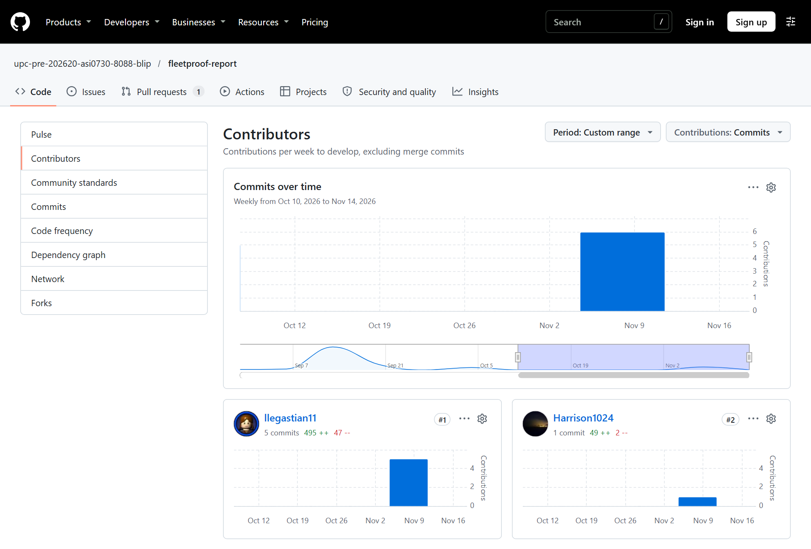
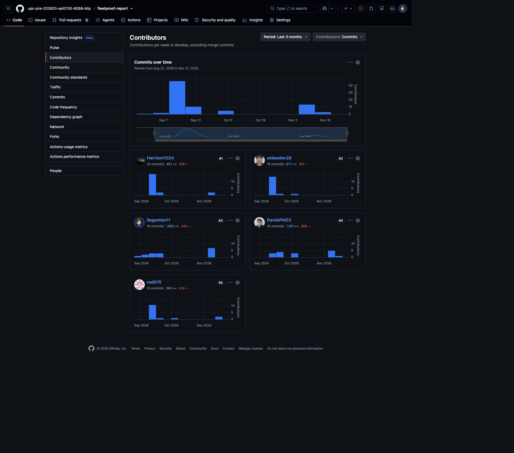

# Registro de Versiones del Informe

| Versión | Fecha | Autor | Descripción de modificación |
|---|---|---|---|
| 0.1.0 | 2026-09-02 | BLIP | Estructura inicial del informe en Markdown hasta Capítulo V. |
| 0.2.0 | 2026-09-13 | Reyes Limo, Sebastian Eduardo | Desarrollo del Capítulo II, evidencias de Needfinding, Big Picture Event Storming y mejora del Ubiquitous Language. |
| 0.3.0 | 2026-09-20 | Reyes Limo, Sebastian Eduardo | Corrección de los datos de colaboración del `README.md` (códigos y usuarios de GitHub), incorporación de los enlaces de los repositorios del proyecto, actualización de los roles y del estado de AV1, conclusiones del Student Outcome por integrante y cierre de los entregables del plan AV1. Se agregó el video About-the-Team y se completaron las evidencias de ejecución del Capítulo V (US01 a US04) y los anexos de entrevistas y de navegación del prototipo. |
| 0.4.0 | 2026-11-15 | BLIP | AV2: se actualizó el Sprint 3 con evidencias de integración y despliegue, las entrevistas de validación y el video About the Team. |

# Project Report Collaboration Insights

## Repositorio

URL del repositorio del informe: https://github.com/upc-pre-202620-asi0730-8088-blip/fleetproof-report

## Estrategia de colaboración

El equipo BLIP elabora el informe en Markdown usando GitHub como sistema de control de versiones. El archivo principal es `README.md` y cada capítulo tiene un archivo independiente en `docs/`, con el fin de reducir conflictos de edición y evidenciar aportes individuales.

## Evidencias por entrega

| Entrega | Evidencia requerida | Estado |
|---|---|---|
| AV1 | Organización del informe, capítulos iniciales y aportes por integrante. | Historial de septiembre y seis PR integrados; la exposición AV1 se referencia en el Anexo A y no se presenta como About-the-Team. |
| TB1 | Desarrollo de la aplicación y revisión de artefactos del Sprint 2. | Capítulo V, Sprint 2, y commits de octubre de los cinco integrantes; Student Outcome TB1 recuperado de `fae26fb`. |
| AV2 | Evidencias ampliadas de colaboración, validación y mejoras. | PR #10 y #12 de evidencia audiovisual; PR #14 de arquitectura. PR #13, #15 y #16 integrados en develop durante la revisión del 25/11/2026, preservando los cambios de Rodrigo y el Student Outcome acumulado. |

## Analíticos de GitHub del informe

Captura histórica del repositorio `fleetproof-report`, rama `develop`, con el período del 10 de octubre al 14 de noviembre de 2026. Esta evidencia corresponde al corte registrado para AV2; no representa los commits de corrección posteriores a la evaluación.

## Analíticos acumulados y correcciones

Captura nativa realizada el 25/11/2026 en [GitHub Contributors](https://github.com/upc-pre-202620-asi0730-8088-blip/fleetproof-report/graphs/contributors), rama `develop`, período visible del 22 de agosto al 21 de noviembre de 2026, excluyendo commits de fusión. GitHub muestra Harrison1024 (20), sebasdev28 (16), llegastian11 (16), DanielPM23 (16) y rod670 (15). Es un corte acumulado calculado por GitHub; no atribuye los commits de las correcciones de hoy a las entregas anteriores.

## Convenciones de GitFlow

| Tipo | Convención |
|---|---|
| Main branch | `main` |
| Development branch | `develop` |
| Documentation branch | `docs/<scope>` |
| Feature branch | `feature/usXXX-<short-name>` |
| Release branch | `release/vX.Y.Z` |
| Hotfix branch | `hotfix/<short-name>` |

## Versiones requeridas por producto

| Producto | Releases requeridos |
|---|---|
| Landing Page | `v1.0.0`, `v2.0.0`, `v3.0.0`, `v4.0.0` |
| Frontend Web Application | `v1.0.0`, `v2.0.0`, `v3.0.0` |
| Web Services | `v1.0.0`, `v2.0.0` |
