# Capítulo V: Product Implementation, Validation & Deployment

## 5.1 Software Configuration Management

### 5.1.1 Software Development Environment Configuration

En esta sección se detallan las herramientas y plataformas de software adoptadas por el equipo para coordinar, diseñar, implementar y documentar el ciclo de vida del producto digital. Se especifican el propósito de uso de cada herramienta, su tipo de ejecución y la ruta de acceso o descarga oficial correspondiente:

| Herramienta / Software | Tipo / Modelo | Propósito en el Proyecto | Actividad Asociada | Enlace de Referencia / Acceso |
| :--- | :--- | :--- | :--- | :--- |
| **Miro** | SaaS (Nube) | Plataforma de pizarra visual colaborativa utilizada para la realización de las dinámicas de *EventStorming* (Big Picture y Design-Level), mapeo de procesos de negocio y exploración visual del dominio. | Requirements Management & Domain Modeling | [https://miro.com/](https://miro.com/) |
| **Figma** | SaaS (Nube) | Herramienta de diseño de interfaces vectoriales y prototipado empleada para definir la guía de estilos visuales, *wireframes*, *mock-ups* y los flujos de interacción del *Landing Page* y la aplicación web. | Product UX/UI Design | [https://figma.com/](https://figma.com/) |
| **HackMD (HackMD.io)** | SaaS (Nube) | Entorno de edición colaborativa en tiempo real en formato Markdown, utilizado para redactar, revisar y sincronizar colectivamente el contenido de las secciones del informe de proyecto. | Project Documentation & Reporting | [https://hackmd.io/](https://hackmd.io/) |
| **GitHub** | SaaS (Nube) | Plataforma de alojamiento de repositorios Git utilizada para la gestión centralizada del código fuente, aplicación del flujo *GitFlow*, seguimiento de *commits*, métricas de contribución y control de versiones del informe del proyecto. | Source Code Management & Collaboration | [https://github.com/](https://github.com/) |

### 5.1.2 Source Code Management

Para garantizar la integridad, trazabilidad y el trabajo colaborativo en el desarrollo de la solución, el equipo utiliza **GitHub** como plataforma centralizada de alojamiento y control de versiones bajo Git.

##### Repositorios del Proyecto

| Producto / Artefacto | Propósito | Enlace al Repositorio en GitHub |
| :--- | :--- | :--- |
| **Project Documentation Report** | Repositorio para la elaboración colaborativa del informe técnico del proyecto en formato Markdown. | [blip-fleetproof-project-report](https://github.com/1ASI0730-8088-Blit/blip-fleetproof-project-report) |
| **Landing Page** | Repositorio del sitio web estático para la presentación comercial y conversión del modelo de negocio. | [fleetproof-landing-page](https://github.com/1ASI0730-8088-Blit/fleetproof-landing-page) |
##### Flujo de Ramas: GitFlow Workflow

El equipo implementa el modelo de flujo de trabajo **GitFlow**, estructurando el ciclo de desarrollo a través de ramas principales y ramas temporales de soporte:

1. **Ramas Principales:**
   * `main`: Contiene el código fuente en estado de producción, estable y totalmente desplegable. Todo cambio en esta rama proviene exclusivamente de fusiones validadas de ramas de lanzamiento (*release*) o parches urgentes (*hotfix*).
   * `develop`: Actúa como la rama de integración continua y base para el desarrollo diario. En ella se consolidan todas las funcionalidades culminadas y revisadas que formarán parte de la siguiente iteración.

2. **Ramas de Soporte:**
   * `feature/<nombre-de-tarea>`: Se desprenden de `develop` para la construcción aislada de una historia de usuario, componente de interfaz o sección de documentación. Una vez completada y verificada la tarea, se integra nuevamente en `develop` a través de un *Pull Request* con revisión previa de pares.
     * *Convención para desarrollo de software:* `feature/<US-ID>-<short-description>` (Ejemplo: `feature/US01-landing-hero`, `feature/US02-pricing-cards`).
     * *Convención para informe de proyecto:* `feature/sprint<n>-capitulo-<id>` (Ejemplo: `feature/sprint1-capitulo-5`).
   * `release/v<MAJOR.MINOR.PATCH>`: Se crean a partir de `develop` al alcanzar el congelamiento de características planeadas para un hito de entrega (Sprint Review). Sirven para realizar pruebas de aceptación finales, ajustes menores de documentación y preparar el despliegue. Se fusionan hacia `main` (etiquetando el lanzamiento) y de vuelta hacia `develop`.
   * `hotfix/v<MAJOR.MINOR.PATCH>`: Se desprenden directamente de `main` en caso de requerir la corrección crítica e inmediata de un defecto en el entorno de producción. Se fusionan simultáneamente a `main` y a `develop`.

##### Versionado Semántico (Semantic Versioning 2.0.0)

Para el control de versiones y etiquetado de los lanzamientos oficiales (*releases*), se adopta el estándar **SemVer 2.0.0** bajo la nomenclatura `vMAJOR.MINOR.PATCH`:

* **MAJOR:** Incrementa ante cambios incompatibles con versiones previas (*breaking changes*) o entregas de arquitectura estructurales mayores (Ejemplo: transición de entregas mayores finales).
* **MINOR:** Incrementa cuando se añaden nuevas funcionalidades, vistas o endpoints que son compatibles con las versiones existentes hacia atrás (Ejemplo: cierre de un nuevo Sprint como `v0.1.0` para Sprint 1, `v0.2.0` para Sprint 2).
* **PATCH:** Incrementa cuando se introducen correcciones de errores, ajustes de accesibilidad o parches menores que no alteran la compatibilidad previa (Ejemplo: `v0.1.1`).

##### Convención de Mensajes: Conventional Commits

Para mantener un historial de confirmaciones (*commits*) claro, legible y automatizable, los mensajes deben redactarse en idioma inglés siguiendo la especificación de **Conventional Commits**:

* **Estructura obligatoria:**
  ```text
  <type>(<scope>): <short description in present tense>

### 5.1.3 Source Code Style Guide & Coding Conventions

Para garantizar la legibilidad, mantenibilidad y consistencia del código fuente a lo largo del ciclo de vida del proyecto, el equipo adopta estándares oficiales de codificación reconocidos en la industria.

Como principio general, todos los identificadores en el código (nombres de archivos, variables, funciones, métodos, clases, interfaces, comentarios en el código y mensajes de error o registros) deben redactarse estrictamente en idioma inglés.

##### Convenciones Generales de Nomenclatura

| Lenguaje / Tecnología | Elemento de Código | Convención de Nomenclatura | Ejemplo |
| :--- | :--- | :--- | :--- |
| **HTML5** | Nombres de etiquetas y atributos | lowercase | `<section class="hero">`, `` |
| **CSS3** | Clases y selectores | kebab-case | `.btn-primary`, `.vehicle-card-header` |
| **JavaScript / Vue** | Variables y funciones | camelCase | `licensePlate`, `fetchVehicleReports()` |
| **JavaScript / Vue** | Constantes globales | UPPER_SNAKE_CASE | `API_BASE_URL`, `DEFAULT_TIMEOUT` |
| **JavaScript / Vue** | Componentes Vue y Clases | PascalCase | `VehicleReport.vue`, `RiskAssessmentService` |
| **C# (.NET Core)** | Clases, Registros y Structs | PascalCase | `Vehicle`, `ReportService` |
| **C# (.NET Core)** | Interfaces | PascalCase con prefijo 'I' | `IVehicleRepository`, `INotificationService` |
| **C# (.NET Core)** | Métodos y Propiedades | PascalCase | `GetByIdAsync()`, `LicensePlate` |
| **C# (.NET Core)** | Variables locales y parámetros | camelCase | `reportId`, `cancellationToken` |
| **C# (.NET Core)** | Campos privados de clase | _camelCase (guion bajo) | `_dbContext`, `_logger` |

##### Estándares por Lenguaje y Marco de Trabajo

###### 1. HTML5
Se adoptan las directrices de la *Google HTML/CSS Style Guide* y las especificaciones de *W3Schools*:
* **Semántica estructural:** Se prioriza el uso de elementos semánticos de HTML5 (`<header>`, `<nav>`, `<main>`, `<section>`, `<article>`, `<footer>`) en lugar de contenedores genéricos `<div>`.
* **Sintaxis limpia:** No se emplean mayúsculas en nombres de elementos o atributos. Todos los valores de atributos deben delimitarse con comillas dobles.
* **Accesibilidad (a11y):** Toda imagen debe incluir el atributo `alt` con una descripción textual representativa. Los elementos interactivos deben incluir atributos ARIA (`aria-label`, `aria-expanded`, etc.) cuando la semántica nativa resulte insuficiente.

###### 2. CSS3
Se adoptan las directrices de la *Google HTML/CSS Style Guide*:
* **Formato e indentación:** Se emplea una indentación consistente de 2 espacios sin tabulaciones.
* **Especificidad de selectores:** Se diseñan estilos basados en clases reutilizables (*kebab-case*). Se restringe estrictamente el uso de selectores de ID (`#`) para aplicar estilos y se evita el uso de declaraciones `!important`.
* **Diseño adaptativo:** Las reglas de visualización adaptable deben organizarse mediante consultas de medios (*Media Queries*) siguiendo el enfoque de diseño responsivo.

###### 3. JavaScript & Vue.js
Se adoptan las directrices de la *Google JavaScript Style Guide* y la *Vue Style Guide*:
* **Declaración de variables:** Se prohíbe el uso de la palabra clave `var`. Se utiliza `const` de manera predeterminada y `let` únicamente cuando la variable requiera reasignación.
* **Componentes Vue:** Los nombres de componentes de archivo único (*Single File Components*) deben estructurarse en *PascalCase* y constar de más de una palabra para evitar colisiones con elementos HTML nativos (por ejemplo, `ReportCard.vue` en lugar de `Card.vue`).
* **Manejo asíncrono:** Se prioriza el uso de la sintaxis `async/await` estructurada con bloques `try/catch` para el consumo de servicios asíncronos y llamadas HTTP.

###### 4. C# & ASP.NET Core
Se adoptan las directrices oficiales de *Microsoft C# Coding Conventions* y *Microsoft ASP.NET Core Coding Guidelines*:
* **Estructura y llaves:** Se sigue el estilo Allman para la apertura y cierre de bloques de código, colocando las llaves (`{ }`) en una línea independiente alineada con el nivel de indentación correspondiente (4 espacios).
* **Inyección de dependencias:** Los servicios y repositorios deben desacoplarse mediante interfaces inyectadas vía constructor, almacenándolos en campos privados de solo lectura (`private readonly`).
* **Operaciones asíncronas:** Todo método asíncrono debe llevar el sufijo `Async` (por ejemplo, `SaveVehicleAsync`) y recibir o propagar un token de cancelación (`CancellationToken`) cuando aplique.


### 5.1.4 Software Deployment Configuration

A continuación, se describen las especificaciones técnicas y los procedimientos de construcción y despliegue de FleetProof. La Landing Page utiliza GitHub Pages; la Web Application del Sprint 2 utiliza Netlify y consume una Fake API desplegada en Render. Esta API de demostración no sustituye los servicios backend de producción.

| Producto | Proveedor | Pasos de construcción y despliegue | Variables por nombre, sin secretos | URL y verificación |
|---|---|---|---|---|
| Landing Page | GitHub Pages | 1. Integración de los cambios terminados hacia la rama `main` mediante Pull Request aprobado.<br>2. En el repositorio de GitHub, navegar a **Settings** > **Pages**.<br>3. En la sección **Build and deployment** > **Source**, seleccionar **Deploy from a branch**.<br>4. En el menú desplegable de rama, elegir `main` y en la carpeta seleccionar `/ (root)`. Presionar **Save**.<br>5. GitHub ejecuta de manera automática el workflow de GitHub Actions denominado `pages-build-deployment`. | No aplica justificado. Al tratarse de un sitio web estático desarrollado con HTML5 semántico, CSS3 y JavaScript vanilla, los archivos son interpretados directamente por el navegador del cliente y no requieren variables de entorno ni compilación del lado del servidor. | URL: `https://upc-pre-202620-asi0730-8088-blip.github.io/fleetproof-website/`<br>Verificación: Respuesta HTTP 200 OK, renderizado responsivo correcto, funcionamiento del selector de idioma (ES/EN), apertura y foco de los modales legales y visualización de notificaciones toast en las llamadas a la acción. |
| Frontend Web Application | Netlify | Vue.js / Vite; construcción con `npm run build`, publicación de `dist/` y redirección SPA. | `VITE_FLEETPROOF_API_URL`, `VITE_AUTH_MODE`, `VITE_PRIME_UI_LICENSE_KEY` | **Done (Sprint 2).** [Aplicación publicada](https://zesty-sorbet-f6d433.netlify.app/login). El panel de Netlify registra la publicación del 10 de octubre de 2026. Evidencia en 5.2.2.5 y 5.2.2.7. |
| Fake Web Services | Render | Node.js / JSON Server; contrato de demostración descrito en 5.2.2.6. | Consultar la configuración y el README del mock; no se publican secretos. | **Done (Sprint 2).** [Health check de la Fake API](https://fleetproof-mock-api.onrender.com/api/v1/health). No incluye fuentes oficiales, pagos reales ni base de datos de producción. |
| Web Services | Render | ASP.NET Core, EF Core y PostgreSQL mediante Docker. | `ConnectionStrings__FleetProof`, `Cors__Origins__0` | [Health check del backend](https://fleetproof-platform.onrender.com/api/v1/health). Evidencia en 5.2.3.7. |

## 5.2 Landing Page, Services & Applications Implementation

### 5.2.1 Sprint 1

#### 5.2.1.1 Sprint Planning 1

El equipo llevó a cabo la sesión de Sprint Planning con el propósito de definir el objetivo central de la iteración, establecer el alcance operativo para el hito AV1 y seleccionar del Product Backlog las historias de usuario orientadas a la implementación, estilizado y despliegue del sitio web estático (Landing Page).

A continuación se presenta el resumen formal de la reunión de planificación del Sprint 1:

| Sprint # | Sprint 1 |
| :--- | :--- |
| **Sprint Planning Background** | |
| **Date** | 2026-08-30 |
| **Time** | 14:00 - 15:30 |
| **Location** | Sesión virtual vía Discord |
| **Prepared By** | Gómez De La Torre Huertas, Rodrigo Fernando |
| **Attendees (to planning meeting)** | Gómez De La Torre Huertas, Rodrigo  / reyes Limo, Sebastian / Palomino Murga, Daniel / Becerra Durand, Sebastian / Payesa Torres Harrison |
| **Sprint 0 Review Summary** | Al tratarse del primer sprint del ciclo de desarrollo, no existe un incremento de software previo sujeto a revisión formal. El equipo consolidó los requerimientos iniciales, los arquetipos de usuario y las directrices de diseño visual en Figma. |
| **Sprint 0 Retrospective Summary** | Como retrospectiva previa, el equipo acordó estandarizar el flujo de trabajo mediante ramas GitFlow y Conventional Commits para evitar conflictos de integración en el repositorio del informe y del producto. |
| **Sprint Goal & User Stories** | |
| **Sprint 1 Goal** | Publicar una página de inicio adaptable y accesible que explique la propuesta de FleetProof a responsables de flotas y propietarios particulares. Se verificará que ambos perfiles puedan comparar los planes, consultar las políticas legales y utilizar las llamadas a la acción correspondientes. |
| **Sprint 1 Velocity** | 11 Story Points |
| **Sum of Story Points** | 11 Story Points |

###### User Stories Comprometidas en el Sprint 1

Para cumplir con el Sprint Goal formulado, se incluyeron en el Sprint Backlog la totalidad de historias de usuario asociadas al Epic EP01 (Landing Page):

* **US001 - View value proposition** (2 Story Points): Presentación visual de la propuesta de valor, segmentos objetivo y llamada a la acción principal.
* **US002 - Fleet monitoring CTA** (2 Story Points): Enlace y redirección de conversión hacia el flujo de incorporación y monitoreo empresarial de flotas.
* **US003 - Vehicle report CTA** (2 Story Points): Enlace y redirección hacia el flujo de consulta y reporte unitario para propietarios y compradores particulares.
* **US004 - Compare plans** (3 Story Points): Cuadro comparativo de los tres planes de suscripción (Personal, Fleet Starter y Fleet Business) con sus respectivos límites y capacidades.
* **US005 - View legal pages** (2 Story Points): Enlaces en el pie de página hacia los Términos y Condiciones del Servicio y las Políticas de Privacidad.


#### 5.2.1.2 Aspect Leaders and Collaborators

| Team Member | GitHub Username | SCM and Rubric | Lean UX | UX Research | Requirements | Product Design and Landing Page |
|---|---|---|---|---|---|---|
| Reyes Limo Sebastian | llegastian11 | L | C | C | C | C |
| Palomino Murga Daniel Stalin | DanielPM23 | C | L | C | C | C |
| Becerra Durand Sebastian Uriel | Sebasdev28 | C | C | L | C | C |
| Gómez De La Torre Huertas Rodrigo Fernando | rod670 | C | C | C | L | C |
| Payesa Torres Harrison Hubert | Harrison1024 | C | C | C | C | L |

#### 5.2.1.3 Sprint Backlog 1

En esta sección se presenta el Sprint Backlog correspondiente al Sprint 1, detallando la descomposición de las historias de usuario del Epic EP01 (Landing Page) en tareas de trabajo (Work-items / Tasks) ejecutables por los miembros del equipo. Cada ítem cuenta con su estimación de esfuerzo en horas, la asignación de un responsable y el seguimiento de su estado de cumplimiento.

###### Tablero de Gestión del Sprint 1

Para el control del flujo de trabajo y seguimiento ágil bajo Kanban/Scrum, el equipo utilizó la plataforma Trello:
* **Enlace público al tablero de gestión:** https://miro.com/welcomeonboard/UGpPdEgzanRlS0RmMFBmWXpyclVZeHJiQVhRRjI0dTZpV0I0czlPeWNyUnVVdWJOcXF3eE8rTEZKMnNBaW1jb1hVYkptMmpacEpSWE0zMXBlcGVEQjNXS2xZSFczaFM3dnl6c3dmVnNJdlY5akRQMjhSZVFOanFHWGhnUVhycVN0R2lncW1vRmFBVnlLcVJzTmdFdlNRPT0hdjE=?share_link_id=821007824686


###### Distribución de Tarjetas en el Tablero Digital

* **Lista: To-do (Por hacer)**
  * *(Vacía al cierre del Sprint 1)*
* **Lista: In-Process (En proceso)**
  * *(Vacía al cierre del Sprint 1)*
* **Lista: To-Review (En revisión / QA)**
  * *(Vacía tras la verificación de criterios de aceptación)*
* **Lista: Done (Completado)**
  * `[T01]` Estructuración HTML semántica del encabezado y Hero (US001) - DanielPM23
  * `[T02]` Estilización CSS responsiva y tokens de diseño Material Design (US001) - Sebasdev28
  * `[T03]` Maquetación de la sección y llamada a la acción empresarial (US002) - Harrison1024
  * `[T04]` Configuración de eventos de redirección para monitoreo de flotas (US002) - Ilegastian
  * `[T05]` Construcción visual del bloque de consulta vehicular para particulares (US003) - DanielPM23
  * `[T06]` Enrutamiento y script de interacción para reporte unitario (US003) - Ilegastian
  * `[T07]` Maquetación HTML de tarjetas de planes de suscripción (US004) - Sebasdev28
  * `[T08]` Diseño responsivo en cuadrícula (CSS Grid/Flexbox) de planes (US004) - DanielPM23
  * `[T09]` Redacción y estructura de Términos de Servicio y Privacidad (US005) - Harrison1024
  * `[T10]` Integración de navegación en el pie de página y metadatos SEO/a11y (US005) - Harrison1024
  * `[T11]` Pipeline de despliegue continuo en Vercel y verificación HTTPS (Restricción) - rod670
  * `[T12]` Documentación técnica del Capítulo V y preparación del informe (Restricción) - rod670

###### Tabla de Control de Estado de Tareas - Sprint 1

**Sprint #: Sprint 1**

| Story Id | Story Title | Task Id | Task Title | Task Description | Estimation (Hours) | Assigned To | Status |
|---|---|---|---|---|---:|---|---|
| **US001** | View value proposition | T01 | **HTML Semantic Layout** | Estructurar el marcado semántico del encabezado y la sección hero principal con la propuesta de valor. | 4 | DanielPM23 (Daniel) | Done |
| **US001** | View value proposition | T02 | **Hero Section Styling** | Aplicar reglas de estilo CSS adaptativas, tipografía y elementos visuales basados en Material Design. | 4 | Sebasdev28 (Becerra) | Done |
| **US002** | Fleet monitoring CTA | T03 | **Enterprise CTA Component** | Maquetar y estilar el componente de llamada a la acción enfocado en administradores de flotas. | 3 | Harrison1024 (Harrison) | Done |
| **US002** | Fleet monitoring CTA | T04 | **Enterprise Redirect Behavior** | Implementar la lógica de redirección y eventos de navegación hacia el flujo empresarial. | 3 | Ilegastian (Reyes) | Done |
| **US003** | Vehicle report CTA | T05 | **B2C CTA Component** | Construir la sección de consulta vehicular individual y diseño del botón de acción para particulares. | 3 | DanielPM23 (Daniel) | Done |
| **US003** | Vehicle report CTA | T06 | **B2C Query Navigation** | Configurar el enrutamiento interactivo para redirigir a los visitantes hacia la consulta por placa. | 3 | Ilegastian (Reyes) | Done |
| **US004** | Compare plans | T07 | **Subscription Pricing Layout** | Diseñar la estructura HTML y tarjetas comparativas para los planes Personal, Fleet Starter y Fleet Business. | 5 | Sebasdev28 (Becerra) | Done |
| **US004** | Compare plans | T08 | **Pricing Grid Responsiveness** | Ajustar el diseño responsivo en cuadrícula (CSS Grid/Flexbox) para la visualización en móviles y escritorio. | 4 | DanielPM23 (Daniel) | Done |
| **US005** | View legal pages | T09 | **Legal Content Views** | Redactar y maquetar los términos de servicio (Terms) y políticas de privacidad (Privacy Policy). | 4 | Harrison1024 (Harrison) | Done |
| **US005** | View legal pages | T10 | **Footer Navigation Links** | Integrar los enlaces de navegación y metadatos de accesibilidad en el pie de página. | 2 | Harrison1024 (Harrison) | Done |
| **General** | Sprint Constraint | T11 | **Deployment Pipeline Setup** | Configurar la integración continua en Vercel vinculada a la rama main de GitHub y validar disponibilidad HTTPS. | 4 | rod670 (Gómez De La Torre) | Done |
| **General** | Sprint Constraint | T12 | **Sprint Documentation & Verification** | Consolidar las evidencias técnicas, matrices y redacción del Capítulo V en el informe Markdown. | 6 | rod670 (Gómez De La Torre) | Done |

Las estimaciones de 2 o 3 horas se conservan como registro histórico del Sprint 1; no cumplen el rango de 4 a 8 horas evaluado en la rúbrica.

#### 5.2.1.4 Development Evidence for Sprint Review

A continuación, se presentan las evidencias de desarrollo y registros de confirmación (*commits*) correspondientes al hito del Sprint 1, organizadas por integrante del equipo mediante capturas directas del historial de Git / GitHub:

| Integrante / Rol | Rama de trabajo | Descripción de aportes | Captura de commits (Git log / GitHub) |
|---|---|---|---|
| **Sebastina Becerra**<br>(Developer) | `implement hero and product benefits sections` | feat 2. | |
| **Daniel Palomino**<br>(Developer) | ` implement landing page navigation and base layout` | feat 1. |  |
| **Rodrigo Gómez De La Torre**<br>(Developer) | `add localization and accessibility suppor` | feat 5. |  |
| **Sebastian Reyes**<br>(Developer) | `implement subscription plans section` | feat 4 | |
| **Harrison Payesa**<br>(Developer) | `implement product solutions and workflow` | feat 3 | |


#### 5.2.1.5 Execution Evidence for Sprint Review

#### 1


#### 2


#### 3


#### 4


A continuación, se presentan las evidencias de ejecución y validación funcional de la Landing Page correspondientes al cierre del Sprint 1, organizadas por historia de usuario y escenarios de prueba:

| User Story / escenario | Resultado esperado | Resultado observado | Captura / video | Estado |
|---|---|---|---|---|
| **US01: Diseño adaptable (Desktop y Móvil)** | La landing page debe adaptarse fluidamente a pantallas de escritorio y dispositivos móviles sin desbordamientos ni textos truncados. | El diseño responsivo se ajusta correctamente en diferentes resoluciones; los bloques de navegación, tarjetas de planes y secciones informativas mantienen legibilidad. | 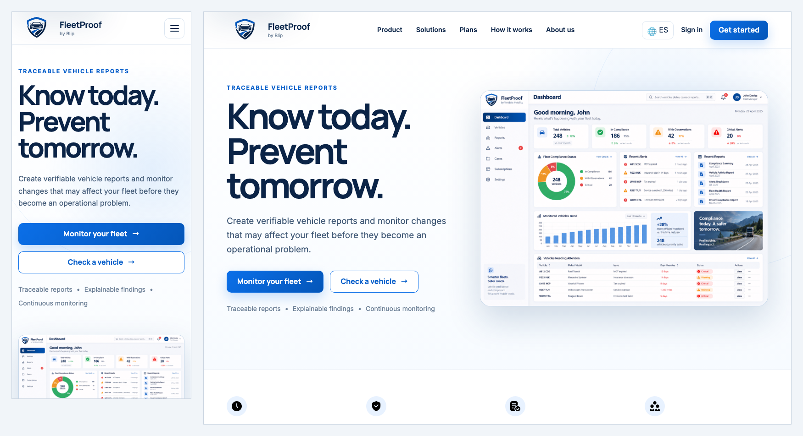 | Aprobado |
| **US02: Soporte Multi-idioma (i18n)** | Al cambiar el selector de idioma (EN/ES), todos los encabezados, descripciones y planes de suscripción deben actualizarse dinámicamente sin recargar la página. | La interfaz actualiza reactivamente los textos en base al atributo `data-i18n`, traduciendo títulos, botones y monedas de manera instantánea. | 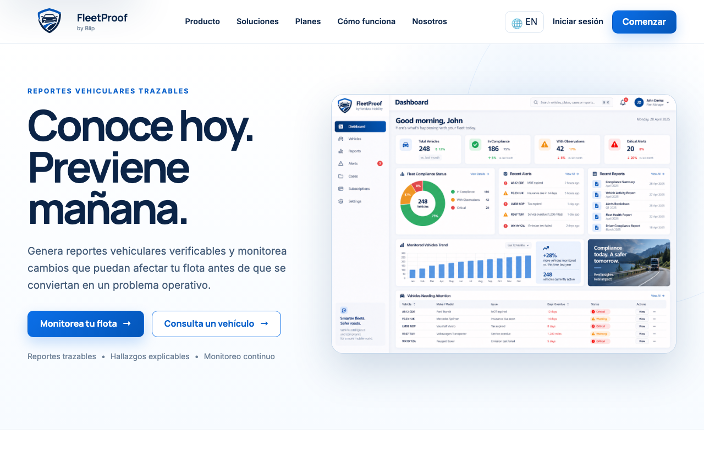 | Aprobado |
| **US03: Diálogos Legales Accesibles** | Al pulsar sobre "Terms" o "Privacy" en el pie de página, debe desplegarse un diálogo modal accesible que presente los términos y permita cerrarse con `Escape` o clic externo. | El modal se renderiza correctamente sobre la interfaz, bloquea la interacción de fondo y se cierra sin inconvenientes al presionar la tecla `Escape` o el botón de cierre. | 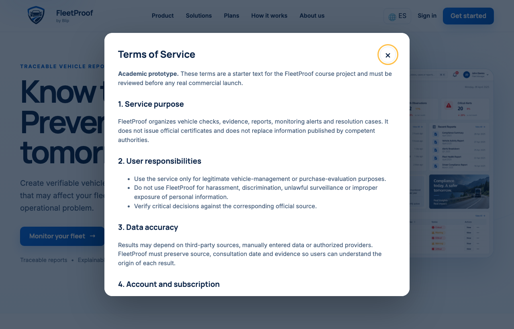 | Aprobado |
| **US04: Enrutamiento de Acciones y Notificaciones Toast** | Al hacer clic en los botones de llamada a la acción (CTA) de los planes o de inicio de sesión, el sistema debe disparar un toast informativo de demostración. | Se despliega la notificación toast flotante en la esquina inferior derecha informando la ruta de demostración configurada, permaneciendo visible temporalmente. | 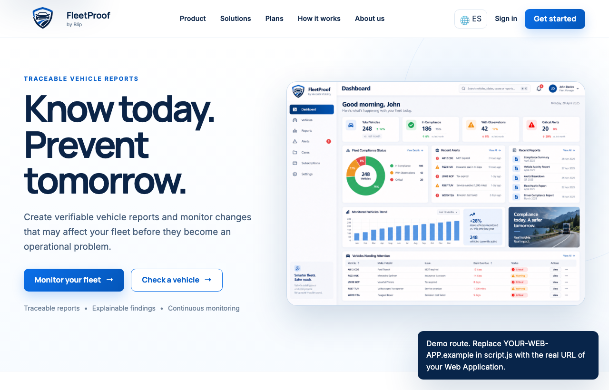 | Aprobado |


#### 5.2.1.6 Services Documentation Evidence for Sprint Review

Durante el desarrollo del **Sprint 1**, el alcance operativo planificado en el Sprint Backlog estuvo focalizado de manera exclusiva en el diseño, estructuración semántica, estilización responsiva, accesibilidad, soporte multi-idioma y despliegue del sitio web estático (Landing Page). 

Por lo tanto, en la presente iteración **no se implementaron servicios web (Web Services / APIs) del lado del servidor**, ni se generaron endpoints operativos ni especificaciones OpenAPI/Swagger.

La arquitectura del backend y los servicios RESTful correspondientes al núcleo de la solución (gestión de flotas, generación de reportes y autenticación) están programados para su diseño e implementación formal a partir del **Sprint 2 (Hito AV2)**. En dicho hito se incorporará la documentación exhaustiva de las APIs, especificaciones interactivas de Swagger/OpenAPI, URLs base de los servicios desplegados y las respectivas evidencias de consumo de endpoints.

#### 5.2.1.7 Software Deployment Evidence for Sprint Review

A continuación, se documenta el registro formal y las evidencias del despliegue en producción de la Landing Page correspondiente al cierre del Sprint 1:

| Producto | Versión / tag real | Commit | URL desplegada | Fecha | Evidencia de despliegue y verificación |
|---|---|---|---|---|---|
| Landing Page | `main` (o `v1.0.0`) | `635ceaa` | `https://upc-pre-202620-asi0730-8088-blip.github.io/fleetproof-website/` | 2026-09-19 |  |

##### Verificación del Despliegue Operativo

* **Plataforma de Alojamiento:** GitHub Pages mediante GitHub Actions workflow (`pages-build-deployment`).
* **Estado de Disponibilidad:** Operativo con código de respuesta HTTP 200 OK.
* **Criterios Validados:** Carga responsiva completa, funcionamiento del selector bilingüe (ES/EN), apertura interactiva de modales legales y notificación flotante (toast) en llamadas a la acción.
#### 5.2.1.8 Team Collaboration Insights during Sprint

| Integrante | Aporte concreto | Evidencia verificable | Revisión o colaboración |
|---|---|---|---|
| Reyes Limo, Sebastian Eduardo | Capitulo número 2 y feat 4 de la landing page | | Completo |
| Palomino Murga, Daniel Stalin | La primera mitad del capitulo 4 y feat 1 de la landing page|  | Completo |
| Becerra Durand, Sebastian Uriel | Segunda mitad del capitulo 4 y feat 2 de la landing page| | Completo |
| Payesa Torres, Harrison Hubert | Capitulos 1 y 3 y feat 3 de la landing page  | | Completo |
| Gómez De La Torre Huertas, Rodrigo Fernando | Capitulo número 5 y feat 5 de la landing| | Completo |

### 5.2.2 Sprint 2

Esta iteración corresponde al hito **TB1** y se centra en una primera Web Application ejecutable, adaptable e integrada con una Fake RESTful API. La documentación se basa en las User Stories y Story Points del Capítulo III, el diseño del Capítulo IV y los commits verificables de los repositorios. El equipo realizó sesiones de trabajo los días **7 y 8 de octubre de 2026**, según lo informado por el Team Leader. Las estimaciones de tareas son propuestas de planificación, no horas efectivamente trabajadas.

#### 5.2.2.1 Sprint Planning 2

El incremento permite al cliente acceder a su cuenta, solicitar un reporte individual por placa mediante pago simulado, descargar su PDF y gestionar vehículos y planes de flota. La información de Consulta Vehicular, SOAT y SBS Accidentes es ficticia: no se implementan extracción de fuentes, pagos reales ni envío de correos.

| Sprint # | Sprint 2 |
|---|---|
| **Sprint Planning Background** | El Sprint 1 entregó el Landing Page de FleetProof para comunicar la propuesta de valor, los segmentos empresarial y particular, los planes y las condiciones legales. Se trabajaron US001-US005 del Epic EP01, con 11 Story Points, y se documentaron el diseño adaptable, la localización ES/EN y la publicación en GitHub Pages. Esta base de negocio, requisitos y diseño permite enfocar el Sprint 2 en la primera Web Application con Vue.js, integrada con una Fake RESTful API mediante JSON Server. El incremento pasa de presentar los servicios a permitir acceso de usuarios, solicitud de reportes por placa, descarga PDF y gestión de vehículos y suscripciones con datos de demostración. |
| Date | 2026-10-07: sesión inicial de trabajo; 2026-10-08: continuación y revisión del incremento. |
| Time | Sesiones realizadas en ambas fechas; hora de inicio y término no registrada en el repositorio. |
| Location | Reuniones de trabajo del equipo; modalidad y plataforma no registradas. |
| Prepared By | Reyes Limo, Sebastian Eduardo; responsable del frontend y consolidación de este registro. |
| Attendees (to planning meeting) | Participación del equipo comunicada por el Team Leader. La relación nominal de asistencia a cada sesión no consta en el registro disponible. |
| Sprint 1 Review Summary | Durante el Sprint 1 se implementaron la propuesta de valor (US001), los CTA de flota y reporte individual (US002 y US003), la comparación de planes (US004) y las páginas legales (US005). El informe registra el Landing Page desplegado en GitHub Pages y evidencias de visualización adaptable, idioma ES/EN, diálogos legales y CTA de demostración. Estos entregables constituyen la base del Sprint 2: el cliente debe poder ejecutar los flujos del producto en una Web Application, no solamente conocer su propuesta comercial. |
| Sprint 1 Retrospective Summary | A partir del trabajo del Sprint 1 se identifica la necesidad de mantener coherencia entre User Stories, wireframes e implementación, mejorar la legibilidad de diagramas y conservar trazabilidad de contribuciones y pruebas. Para la siguiente etapa se organiza el frontend por los seis bounded contexts del Capítulo IV, reutilizando componentes e infraestructura compartidos. También se diferencia el alcance de demostración de los servicios reales: pagos, fuentes oficiales y correos no se consideran integrados por disponer de una Fake API. Esta síntesis se basa en los artefactos y correcciones del repositorio. |
| **Sprint Goal & User Stories** | |
| Sprint 2 Goal | Permitir que particulares obtengan un reporte vehicular y que responsables de flota gestionen sus vehículos desde la aplicación publicada. Se verificará que un usuario pueda iniciar sesión, ingresar una placa válida, confirmar un pago simulado y descargar el reporte PDF; y que un responsable pueda registrar o importar vehículos, filtrar su flota y consultar el plan y su consumo mediante la API simulada. |
| Sprint 2 Velocity | **31 Story Points como capacidad objetivo propuesta** para las nueve historias seleccionadas. Se diferencia de la velocidad lograda, que se calcula con historias aceptadas al cierre; los 11 SP del Sprint 1 no se extrapolan como medición de esta iteración. |
| Sum of Story Points | **31 SP** para la propuesta de selección indicada a continuación; no representa velocidad lograda ni aceptación de todas las historias. |

| Story Id | Story Title | Story Points | Alcance propuesto y límites |
|---|---|---:|---|
| US006 | Manage user access | 3 | Registro, inicio y cierre de sesión, persistencia de sesión y acceso a datos propios. Perfil adicional sujeto a aprobación del backlog. |
| US007 | View plan usage | 2 | Visualización de consumo y plan; cuotas de demostración, no tarifas comerciales aprobadas. |
| US008 | Register vehicle | 3 | Registro y validación de vehículos de la cuenta, organización por flotas. |
| US009 | Import vehicles | 5 | Importación CSV y reporte de filas inválidas. |
| US010 | Search and filter fleet | 3 | Búsqueda y filtros de tipo, sede y riesgo, incluyendo resultados vacíos. |
| US011 | Request vehicle report | 3 | Solicitud individual por placa y confirmación de pago simulada; sin consulta oficial real. |
| US015 | Download vehicle report | 2 | PDF con diseño, placa, fecha y las tres fuentes ficticias consultadas. |
| US017 | Prioritize critical vehicles | 5 | Dashboard y diferenciación de unidades por riesgo simulado. |
| US020 | Provide vehicle report API | 5 | Endpoints de reportes en Fake RESTful API; no constituye el backend definitivo en C#. |

**Ajuste de alcance de cierre:** la [revisión de criterios en el Capítulo III](04-chapter-3-requirements-specification.md) conserva los identificadores de US012–US015 y US018–US019 y distingue el flujo automático de demostración de las integraciones futuras. US007 y US011 documentan la frecuencia del plan y el pago simulado. Los cambios no amplían retroactivamente las historias comprometidas en Sprint 2 ni declaran aceptación grupal.

#### 5.2.2.2 Aspect Leaders and Collaborators

La matriz registra la distribución de responsabilidad por bounded context indicada por el Team Leader para que los cinco integrantes participen en revisión, pruebas y mejoras del incremento. **L** indica responsable del contexto y **C** colaborador. Esta asignación no modifica la autoría del código existente ni acredita tareas futuras como realizadas.

| Team Member | GitHub Username | Fleet Management | Report Management | IAM | Subscription Management | Vehicle Monitoring | Vehicle Information |
|---|---|---|---|---|---|---|---|
| Reyes Limo, Sebastian Eduardo | llegastian11 | L | L | C | C | C | C |
| Palomino Murga, Daniel Stalin | DanielPM23 | C | C | L | C | C | C |
| Becerra Durand, Sebastian Uriel | sebasdev28 | C | C | C | C | C | L |
| Gómez De La Torre Huertas, Rodrigo Fernando | rod670 | C | C | C | C | L | C |
| Payesa Torres, Harrison Hubert | Harrison1024 | C | C | C | L | C | C |

Cada responsable revisará su contexto, comprobará sus escenarios y registrará sus propias mejoras y evidencias en una rama feature. Las contribuciones previas se mantienen en 5.2.2.8 con sus autores reales. Subir una copia del código existente no sustituye un aporte técnico propio ni justifica reescribir el historial.

#### 5.2.2.3 Sprint Backlog 2

Las tareas descomponen el objetivo del incremento en actividades de **4 a 8 horas estimadas**, según la rúbrica. Los estados permitidos son **To Do, In Process, To Review y Done**. Se usa To Review cuando hay implementación o evidencia parcial pero falta validar todos los criterios; disponer de una pantalla no implica que la historia completa esté aceptada.

**Board del Sprint 2:** URL pública y captura no incorporadas en esta versión. La tabla siguiente no sustituye la evidencia de evolución de tarjetas en una herramienta ágil. No se reutiliza la captura del Sprint 1 como evidencia de este sprint.

**Sprint #: Sprint 2**

| Story Id | Story Title | Task Id | Task Title | Task Description | Estimation (Hours) | Assigned To | Status |
|---|---|---|---|---|---:|---|---|
| US006 | Manage user access | S2-T01 | Implement user access | Implementar registro, inicio y cierre de sesión contra la Fake API. | 6 | DanielPM23 | Done |
| US006 | Manage user access | S2-T02 | Isolate account resources | Conservar sesión y restringir recursos por usuario en la API simulada. | 6 | DanielPM23 | Done |
| US007 | View plan usage | S2-T03 | Display plan usage | Mostrar consumo de vehículos, reportes y monitoreos con cuotas de demostración. | 4 | Harrison1024 | Done |
| US007 | View plan usage | S2-T04 | Simulate plan payment | Seleccionar frecuencia semanal/mensual, mostrar QR ficticio y guardar confirmación simulada. | 4 | Harrison1024 | Done |
| US008 | Register vehicle | S2-T05 | Implement vehicle registration | Validar placa y campos obligatorios, guardar vehículos de la cuenta y organizar flotas desde la misma vista. | 6 | llegastian11 | Done |
| US009 | Import vehicles | S2-T06 | Import fleet CSV | Procesar archivo CSV, incorporar filas válidas y mostrar errores de filas rechazadas. | 6 | llegastian11 | Done |
| US010 | Search and filter fleet | S2-T07 | Implement fleet filters | Buscar por texto y filtrar tipo, sede y riesgo; verificar escenario sin coincidencias. | 4 | llegastian11 | Done |
| US011 | Request vehicle report | S2-T08 | Request individual report | Capturar placa válida sin exigir registro previo en una flota. | 4 | llegastian11 | Done |
| US011 | Request vehicle report | S2-T09 | Simulate individual payment | Mostrar diálogo de pago y QR ficticio; crear reporte con tres fuentes simuladas después de confirmar. | 4 | llegastian11 | Done |
| US015 | Download vehicle report | S2-T10 | Generate report PDF | Generar documento con diseño FleetProof, placa, fecha y resultados ficticios de las tres fuentes. Evidencia: figura 5.2.2-4. | 6 | llegastian11 | Done |
| US017 | Prioritize critical vehicles | S2-T11 | Display fleet risk | Mostrar indicadores, tabla de vehículos y distribución de riesgo con datos simulados de la cuenta. | 4 | llegastian11 | Done |
| US020 | Provide vehicle report API | S2-T12 | Configure Fake RESTful API | Exponer recursos de reportes y demás contextos mediante JSON Server con autenticación de demostración. | 6 | sebasdev28 | Done |
| General | Sprint constraint | S2-T13 | Deploy frontend and Fake API | Configurar Netlify y Render gratuitos, URL HTTPS de API, redirección SPA y comprobar la versión publicada. | 4 | llegastian11 | Done |
| General | Sprint constraint | S2-T14 | Validate responsive experience | Revisar escritorio y móvil, navegación, diálogos y errores; incorporar evidencias. | 6 | DanielPM23 / rod670 | Done |
| General | Sprint constraint | S2-T15 | Align automatic report workflow | Retirar revisión/publicación manual, revisar Casos y consolidar Monitoreo en Flota conforme al flujo aclarado. | 6 | llegastian11 / rod670 | Done |
| General | Sprint constraint | S2-T16 | Complete sprint evidence | Confirmar reunión y matriz; adjuntar tablero, video, analíticos y aceptación por historia. | 4 | rod670 | In Process |
| General | Sprint constraint | S2-T17 | Update product backlog | Revisar US012-US015, US018-US019 y criterios de pago y frecuencia sin atribuir integraciones reales a la simulación. Evidencia: criterios y Product Backlog del Capítulo III. | 4 | Harrison1024 | Done |

**Esfuerzo estimado propuesto: 84 horas.** No corresponde a tiempo consumido ni disponibilidad confirmada. Los estados Done de tareas técnicas no declaran terminada la historia cuando existen otros criterios sin validación de aceptación.

**Balance documentado:** 16 tareas Done y 1 In Process (S2-T16). Se completó la revisión documental S2-T17. Las comprobaciones locales del 11 de noviembre de 2026 no implican un nuevo despliegue ni cambian la fecha del Sprint 2.

#### 5.2.2.4 Development Evidence for Sprint Review

Se implementó el frontend por bounded context, una Fake API separada, aislamiento de recursos por cuenta, mejoras adaptables, perfil, PDF de demostración y pagos simulados. Los mensajes y fechas siguientes se obtienen del historial Git; los commits listados no tienen cuerpo adicional, por lo que se registra esa ausencia sin inventar descripciones.

Organización: [upc-pre-202620-asi0730-8088-blip](https://github.com/upc-pre-202620-asi0730-8088-blip). Los repositorios de implementación son [fleetproof-webapp](https://github.com/upc-pre-202620-asi0730-8088-blip/fleetproof-webapp) y [fleetproof-mock-platform](https://github.com/upc-pre-202620-asi0730-8088-blip/fleetproof-mock-platform).

| Repository | Branch | Commit Id | Commit Message | Commit Message Body | Committed on (Date) |
|---|---|---|---|---|---|
| fleetproof-webapp | feature/sprint2-frontend-foundation | [59a5cb3](https://github.com/upc-pre-202620-asi0730-8088-blip/fleetproof-webapp/commit/59a5cb3) | feat: initialize FleetProof frontend from course guide | Sin cuerpo adicional | 2026-10-06 |
| fleetproof-webapp | feature/sprint2-frontend-foundation | [a48a0f4](https://github.com/upc-pre-202620-asi0730-8088-blip/fleetproof-webapp/commit/a48a0f4) | feat: align frontend with report bounded contexts | Sin cuerpo adicional | 2026-10-06 |
| fleetproof-webapp | feature/sprint2-frontend-foundation | [c90e0d3](https://github.com/upc-pre-202620-asi0730-8088-blip/fleetproof-webapp/commit/c90e0d3) | build: prepare frontend and mock API for free hosting | Sin cuerpo adicional | 2026-10-07 |
| fleetproof-webapp | feature/sprint2-frontend-foundation | [964d25c](https://github.com/upc-pre-202620-asi0730-8088-blip/fleetproof-webapp/commit/964d25c) | fix: persist sessions and isolate user data with mobile navigation | Sin cuerpo adicional | 2026-10-08 |
| fleetproof-webapp | feature/sprint2-frontend-foundation | [4453b5a](https://github.com/upc-pre-202620-asi0730-8088-blip/fleetproof-webapp/commit/4453b5a) | feat: align workspace design and add account settings and demo report PDF | Sin cuerpo adicional | 2026-10-08 |
| fleetproof-webapp | feature/sprint2-frontend-foundation | [c5cd5ee](https://github.com/upc-pre-202620-asi0730-8088-blip/fleetproof-webapp/commit/c5cd5ee) | feat: add simulated payments for individual reports and fleet plans | Sin cuerpo adicional | 2026-10-08 |
| fleetproof-mock-platform | feature/sprint2-mock-api | [3dc8f9a](https://github.com/upc-pre-202620-asi0730-8088-blip/fleetproof-mock-platform/commit/3dc8f9a) | feat: initialize FleetProof fake REST API | Sin cuerpo adicional | 2026-10-07 |
| fleetproof-mock-platform | feature/sprint2-mock-api | [9ce8c74](https://github.com/upc-pre-202620-asi0730-8088-blip/fleetproof-mock-platform/commit/9ce8c74) | fix: isolate mock data by authenticated user | Sin cuerpo adicional | 2026-10-08 |
| fleetproof-mock-platform | feature/sprint2-mock-api | [a2526f2](https://github.com/upc-pre-202620-asi0730-8088-blip/fleetproof-mock-platform/commit/a2526f2) | feat: support account settings and demo resource limits | Sin cuerpo adicional | 2026-10-08 |

La tabla evidencia implementación, no aprobación de Pull Requests ni evolución completa de GitFlow. Falta adjuntar capturas de commits y analíticos de GitHub, así como aportes de los demás integrantes en cada producto que corresponda. La nueva versión del Landing Page exigida por TB1 requiere su propia evidencia y no se declara completada por publicar el frontend.

#### 5.2.2.5 Execution Evidence for Sprint Review

Las capturas documentan vistas reales del incremento y pruebas realizadas durante su desarrollo. Se distingue evidencia local de versión pública y no se afirma una cobertura completa de aceptación.

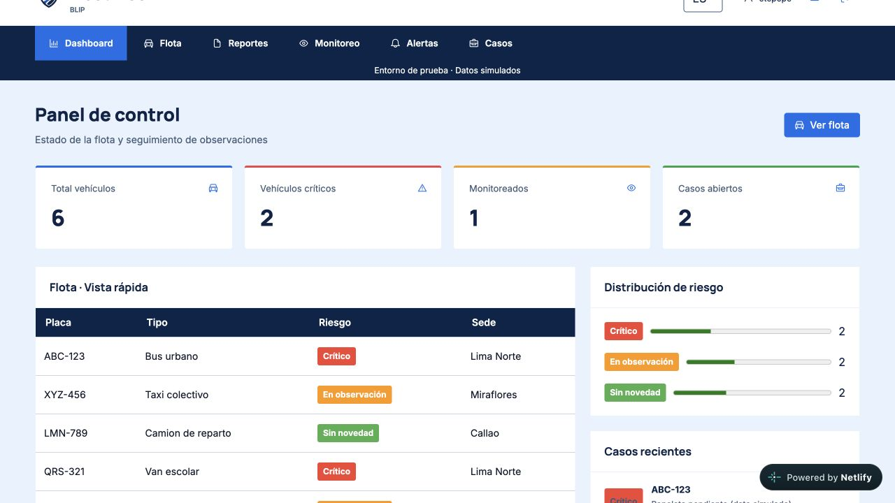

Figura 5.2.2-1. Dashboard publicado: indicadores y vehículos con datos ficticios de demostración.

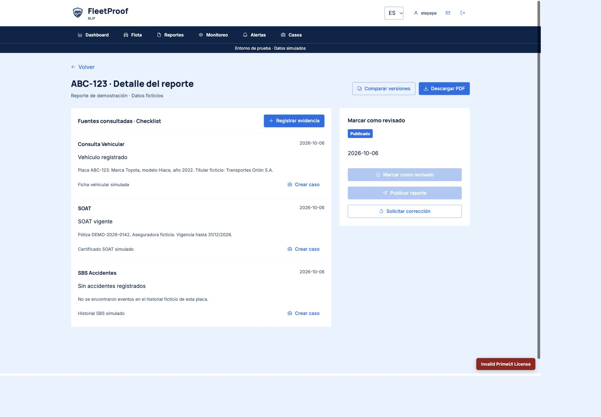

Figura 5.2.2-2. Captura histórica del detalle de reporte, con los controles manuales que se retiraron en la corrección local de S2-T15.

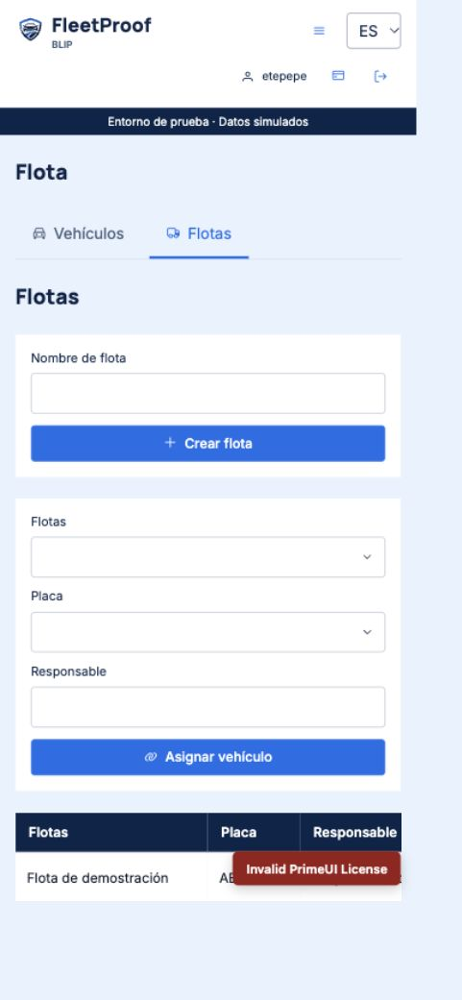

Figura 5.2.2-3. Vista móvil de Flota durante pruebas locales; no sustituye validación de todas las vistas en producción.

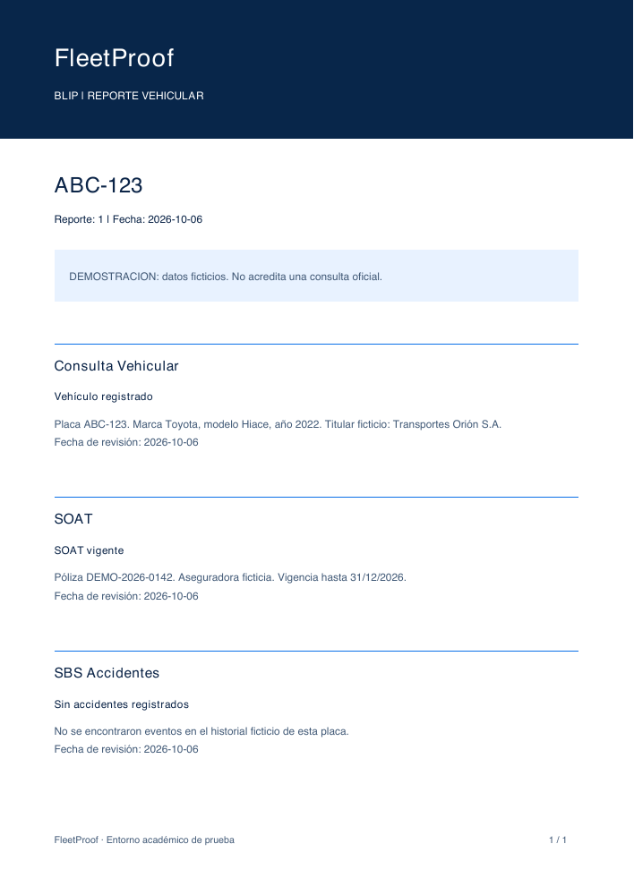

Figura 5.2.2-4. Documento PDF de demostración generado desde un reporte.

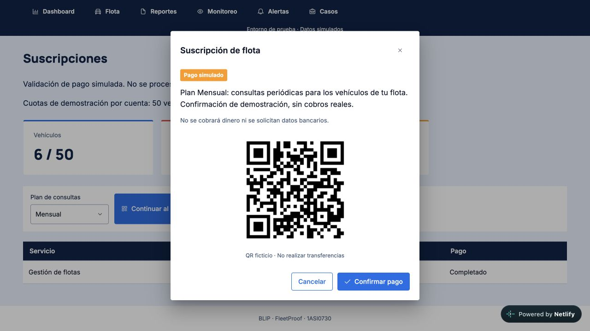

Figura 5.2.2-5. Suscripción publicada: QR ficticio, advertencia de no transferir dinero y confirmación simulada.

| Escenario | Resultado observado | Alcance de la comprobación |
|---|---|---|
| Inicio de sesión y recursos de cuenta | La aplicación consume autenticación y recursos de la Fake API; se implementó aislamiento de datos por usuario. | Confirmar todos los criterios de US006 en revisión de aceptación. |
| Solicitud individual DEM-123 | Tras confirmar pago simulado en pruebas locales, se creó un reporte publicado y se habilitó Descargar PDF. | Datos ficticios; no acredita existencia real de la placa ni disponibilidad de fuentes oficiales. |
| Plan semanal | La confirmación guardó el plan en la API local; la tabla mantuvo Semanal después de recargar. | No prueba ejecución periódica del servidor. |
| Pago en producción | Se visualizó el diálogo y el QR ficticio en Netlify sin efectuar pago real. | No se modificó la suscripción de producción durante esta comprobación. |
| PDF | Se generó un PDF de demostración con identificación y resultados de las fuentes. | Falta validación grupal del contenido y criterios actualizados de US015. |

**Video de navegación:** evidencia audiovisual no incorporada en esta versión. Debe demostrar acceso, reporte individual, pago ficticio, PDF, Flota y suscripción, incluyendo escritorio y móvil. No se inventa URL, duración ni participantes.

##### Verificación local de las correcciones de Sprint 2

El 11 de noviembre de 2026 se ejecutó en Chrome una prueba reproducible (`scripts/sprint2-smoke.mjs`, en el frontend local) contra JSON Server en un puerto local, con un archivo de datos de prueba separado. No se usaron datos de producción.

| Tareas | Comprobación |
|---|---|
| S2-T01, S2-T02 | Registro, login, sesión conservada tras recargar, cierre de sesión y segunda cuenta sin acceso a los recursos de la primera. |
| S2-T03 | Cuotas mostradas con los datos de la prueba: 2 de 50 vehículos, 1 de 100 reportes y 1 de 25 monitoreos activos. |
| S2-T05, S2-T06, S2-T07 | Alta de vehículo, creación de flota y asignación; CSV con una fila válida y dos inválidas procesado sin descartar la válida; filtros de tipo, sede y riesgo y búsqueda sin coincidencias. |
| S2-T11, S2-T12 | Distribución de riesgo visible en el panel; health check del mock, autenticación y consultas a los ocho recursos protegidos; reportes persistidos por la Mock API. |
| S2-T14 | Navegación en escritorio y vista móvil de 390 px; diálogo de alta, error visible de placa inválida y pantalla de flotas sin desborde horizontal de página. |
| S2-T15 | Reporte de flota publicado automáticamente con PDF descargable, sin controles de publicación manual. Creación de caso desde un hallazgo y activación de monitoreo desde Flota. Pagos y fuentes siguen siendo simulados. |

La prueba no acredita horarios de reunión, aprobación grupal de historias ni publicación de videos. La revisión de criterios consta por separado en el Capítulo III.

##### Matriz de verificación por historia

Esta matriz registra ejecución técnica, no una firma de aceptación. El tablero histórico y la aceptación del equipo no se deducen de estos resultados.

| Historia | Resultado comprobado | Fuente |
|---|---|---|
| US006 | Registro, inicio, persistencia y cierre de sesión; aislamiento entre cuentas. | Prueba local, S2-T01 y S2-T02. |
| US007 | Consumo de los tres recursos y activación simulada; persistencia del plan registrada en la prueba previa. | Tabla de escenarios y prueba local, S2-T03 y S2-T04. |
| US008 | Registro de vehículo, alta de flota y asignación con responsable. | Prueba local, S2-T05. |
| US009 | Una fila válida persistida y dos inválidas rechazadas en el mismo CSV. | Prueba local, S2-T06. |
| US010 | Filtros de tipo, sede y riesgo; búsqueda sin coincidencias. | Prueba local, S2-T07. |
| US011 | Solicitud individual DEM-123 y publicación después del pago simulado. | Tabla de escenarios, S2-T08 y S2-T09. |
| US015 | Generación y descarga de PDF con fuentes de demostración. | Figura 5.2.2-4 y prueba local. |
| US017 | Panel con distribución de vehículos por nivel de riesgo. | Figura 5.2.2-1 y prueba local, S2-T11. |
| US020 | Health check, autenticación, creación y consulta de reportes en Mock API. La prueba documentada no certifica todos los códigos de error del contrato. | Prueba local, S2-T12, y contrato en 5.2.2.6. |

#### 5.2.2.6 Services Documentation Evidence for Sprint Review

El servicio de esta entrega es una **Fake RESTful API basada en JSON Server**, utilizada para integración del frontend. No se presenta como backend definitivo en ASP.NET Core ni como integración real con fuentes externas. Base pública: [https://fleetproof-mock-api.onrender.com/api/v1](https://fleetproof-mock-api.onrender.com/api/v1).

La descripción de ejecución y limitaciones se encuentra en el [README del mock](https://github.com/upc-pre-202620-asi0730-8088-blip/fleetproof-mock-platform). Los commits de esta API están registrados en 5.2.2.4. **OpenAPI y documentación interactiva: no implementados en este incremento**; la tabla siguiente describe el contrato implementado y no sustituye ese artefacto exigido por la guía.

| Endpoint | Acciones implementadas | Parámetros y ejemplo | Response y significado |
|---|---|---|---|
| /health | GET | GET /api/v1/health; sin autenticación. | 200, objeto con status: ok y time en formato ISO. Verifica disponibilidad del servicio. |
| /authentication/sign-up | POST | JSON con username y password ficticios. | Creación de cuenta de demostración; conflictos de usuario deben manejarse como errores. |
| /authentication/sign-in | POST | JSON con username y password ficticios. | 200 con token y datos de usuario; credenciales inválidas no generan sesión. |
| /account | GET, PATCH, DELETE | Authorization: Bearer token; modificaciones del perfil requieren los campos definidos por el middleware. | Cuenta propia, actualización o eliminación; no es un catálogo público de usuarios. |
| /vehicles | GET, POST | Token; registro con plate, type, site y owner. | Lista de vehículos propios o recurso creado. |
| /fleets y /assignments | GET, POST, PUT, DELETE | Token; identificador del recurso en operaciones individuales. | Flotas y asignaciones de la cuenta autenticada. |
| /reports y /reports/{id} | GET, POST, PUT, DELETE | Token; id para detalle. Ejemplo: GET /api/v1/reports/1. | Lista o reporte con plate, requestedAt, status y findings; 404 si el recurso no existe o no está disponible para esa cuenta. |
| /subscriptions | GET, POST, PUT | Token; service, plan, status y paymentStatus de demostración. | Plan almacenado y estado simulado; no verifica cobro en una pasarela. |
| /monitorings, /alerts y /cases | GET, POST, PUT, DELETE | Token; id para operaciones individuales. | Recursos simulados propios; no implica correos enviados ni tareas ejecutadas en segundo plano. |

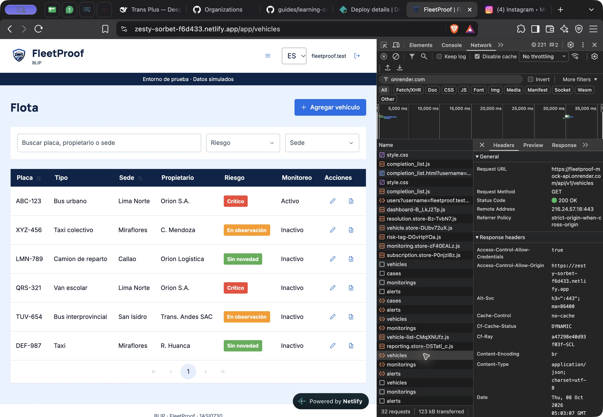

Figura 5.2.2-6. Comprobación de solicitudes de la Web Application hacia la Fake API. Debe complementarse con ejemplos de errores y documentación interactiva cuando se implementen Web Services reales.

**Limitaciones:** contraseñas ficticias almacenadas sin protección de producción, tokens temporales y almacenamiento efímero. No introducir datos personales, contraseñas reutilizadas ni información de pago.

#### 5.2.2.7 Software Deployment Evidence for Sprint Review

Se desplegó el frontend en Netlify y el mock en Render para disponer de una versión pública sin depender del servidor local. Azure no se utilizó en este incremento.

| Producto | Rama / commit | Configuración aplicada | URL | Evidencia |
|---|---|---|---|---|
| Frontend Web Application | feature/sprint2-frontend-foundation / c5cd5ee | npm run build; salida dist; redirección SPA hacia index.html; VITE_FLEETPROOF_API_URL con base HTTPS del mock. | [FleetProof Web Application](https://zesty-sorbet-f6d433.netlify.app) | Figura 5.2.2-5; versión de pagos verificada el 2026-10-08. |
| Fake RESTful API | feature/sprint2-mock-api / a2526f2 | Render Web Service Free; npm ci; npm start; HOST=0.0.0.0; PORT proporcionado por Render; health check /api/v1/health. | [Health de la Fake API](https://fleetproof-mock-api.onrender.com/api/v1/health) | Figura 5.2.2-6 y configuración versionada en el repositorio. |
| Landing Page | Nueva versión TB1 sin evidencia de publicación | Mantener el despliegue existente y documentar los cambios del sprint, versión, commit y CTA hacia Web Application. | URL actual no verificada tras cambio de nomenclatura. | No se usa la evidencia AV1 para afirmar nueva versión TB1. |

Variables del frontend por nombre, sin valores secretos: VITE_FLEETPROOF_API_URL, VITE_AUTH_MODE y VITE_PRIME_UI_LICENSE_KEY. La clave de licencia no se incluye en el informe. No se creó un tag de release para estos commits.

Render Free puede suspender la instancia por inactividad y demorar la primera solicitud; reinicios o despliegues pueden perder datos escritos en el almacenamiento efímero. Persistir temporalmente registros en JSON Server no equivale a disponer de una base de datos de producción. Falta adjuntar capturas de configuración y logs de despliegue de ambos proveedores para completar la evidencia procedimental exigida.

#### 5.2.2.8 Team Collaboration Insights during Sprint

El historial permite comprobar implementación del frontend y mock por Sebastian Reyes, además de correcciones de diseño realizadas por otros integrantes en el informe. No se atribuyen commits del frontend a compañeros que no figuran en ese repositorio ni se declara participación completa del equipo sin evidencias.

| Integrante | Aporte verificable de Sprint 2 | Evidencia | Actividad de cierre |
|---|---|---|---|
| Reyes Limo, Sebastian Eduardo | Frontend, Fake API, aislamiento de cuentas, PDF, pagos simulados y actualización de imágenes Event Storming. | Commits de 5.2.2.4; [38db5f3 del informe](https://github.com/upc-pre-202620-asi0730-8088-blip/fleetproof-report/commit/38db5f3). | Incorporar analíticos, tablero y aceptación grupal. |
| Palomino Murga, Daniel Stalin | Reemplazo de diagramas por imágenes y adición de componentes backend al Capítulo IV. | [dbcfa37](https://github.com/upc-pre-202620-asi0730-8088-blip/fleetproof-report/commit/dbcfa37), [6909446](https://github.com/upc-pre-202620-asi0730-8088-blip/fleetproof-report/commit/6909446). | Confirmar tareas adicionales de implementación y revisión para TB1. |
| Becerra Durand, Sebastian Uriel | Actualización de diagramas de clases del Capítulo IV. | [2a22184](https://github.com/upc-pre-202620-asi0730-8088-blip/fleetproof-report/commit/2a22184). | Confirmar tareas adicionales de implementación y revisión para TB1. |
| Gómez De La Torre Huertas, Rodrigo Fernando | Correcciones de diagramas en 4.6.3 y 4.6.4. | [d50ed57](https://github.com/upc-pre-202620-asi0730-8088-blip/fleetproof-report/commit/d50ed57). | Confirmar tareas adicionales de documentación e implementación para TB1. |
| Payesa Torres, Harrison Hubert | Implementación de la vista, store y recursos de Subscription Management. | Historial de frontend: `ff97dd4`, `70d9f09`, `0b8d0a5`, `520f70c`, visibles en la captura completa. | La revisión posterior de criterios se registra por separado en S2-T17. |

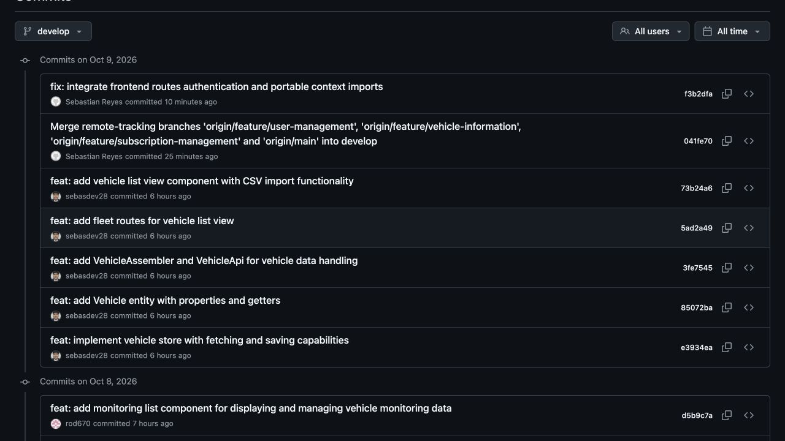

Figura 5.2.2-7. Historial de commits del frontend durante TB1. La [captura completa](assets/chapter-5/sprint-2/sprint2-team-commits-completo.jpg) muestra aportes de los cinco integrantes; no equivale a la pantalla de analíticos de GitHub. El gráfico del repositorio del informe está en [Project Report Collaboration Insights](00-report-control.md#distribución-de-commits-del-informe).

**S2-T16:** se adjuntaron la matriz de responsabilidades, la matriz de verificación técnica y la captura del historial. Para cerrar la tarea según su alcance faltan URL y captura del tablero original, video de navegación, capturas nativas de analíticos y constancia de horarios y aceptación del equipo. No se presentan reconstrucciones como evidencia histórica.

### 5.2.3 Sprint 3

El incremento de AV2 conecta la Web Application Vue con los Web Services de FleetProof en ASP.NET Core, EF Core y PostgreSQL. El alcance verificado es local: suscripción, vehículos y flotas; además, el panel muestra reportes y sus detalles. Los cobros y las fuentes vehiculares externas no forman parte de la integración real de este incremento.

#### 5.2.3.1 Sprint Planning 3

| Sprint # | Sprint 3 |
|---|---|
| **Sprint Planning Background** | Sprint 2 permitió demostrar Vue sobre una Fake RESTful API. Sprint 3 incorpora servicios con persistencia relacional y conserva el contrato de los recorridos principales. La validación ayuda a distinguir consulta puntual, gestión de flota y seguimiento. |
| Date | No consta la fecha de una reunión formal de planificación en la evidencia revisada. |
| Time | Inicio y fin no registrados. |
| Location | No documentada. |
| Prepared By | Equipo BLIP; registro consolidado a partir del código y pruebas disponibles. |
| Attendees (to planning meeting) | Asistencia a la reunión no verificada. |
| Sprint 2 Review Summary | Quedaron verificados los recorridos del frontend y de la Mock API en escritorio y móvil. |
| Sprint 2 Retrospective Summary | El historial del informe permite identificar oportunidades: registrar pruebas con su versión y ambiente, y distinguir evidencia de ejecución de evidencia de publicación. No se presenta como acta de retrospectiva. |
| **Sprint Goal & User Stories** | |
| Sprint 3 Goal | Permitir que un usuario active un plan, registre un vehículo y lo asigne a una flota desde FleetProof. La asignación debe seguir visible tras recargar, no ser accesible por otra cuenta y las escrituras deben quedar bloqueadas sin un plan activo. |
| Sprint 3 Velocity | Capacidad no acordada en un acta verificable. |
| Sum of Story Points | No se calcula una velocidad ni un compromiso a partir del borrador de tareas. |

#### 5.2.3.2 Aspect Leaders and Collaborators

Distribución propuesta para completar AV2, no registro de aportes ya realizados. L = líder; C = colaborador. La autoría verificable se registra en 5.2.3.4 y 5.2.3.8.

| Team Member | GitHub Username | Web Services | Web Application | Arquitectura | Validación | Landing y audiovisual |
|---|---|---|---|---|---|---|
| Reyes Limo, Sebastian Eduardo | llegastian11 | L | C | C | | |
| Palomino Murga, Daniel Stalin | DanielPM23 | C | L | | C | |
| Becerra Durand, Sebastian Uriel | sebasdev28 | C | | L | | |
| Gómez De La Torre Huertas, Rodrigo Fernando | rod670 | C | C | | L | C |
| Payesa Torres, Harrison Hubert | Harrison1024 | | | | C | L |

#### 5.2.3.3 Sprint Backlog 3

Las tareas se vinculan a historias existentes cuando corresponde; los ítems transversales se registran como técnicos. Las horas son estimaciones propuestas, no horas reales. El estado Done corresponde al alcance verificado de cada tarea. S3-T01 a S3-T05 cuentan con pruebas locales y S3-T09 y S3-T10 con evidencia de publicación. La aceptación de las historias se registra por separado. Falta adjuntar URL pública y captura del tablero real.

**Sprint #: Sprint 3**

| Story Id | Story Title | Task Id | Task Title | Task Description | Estimation (Hours) | Assigned To | Status |
|---|---|---|---|---|---:|---|---|
| US006 | Manage user access | S3-T01 | Persist and isolate accounts | Probar registro, login y separación de recursos con PostgreSQL. | 6 | llegastian11 | Done |
| US007 | View plan usage | S3-T02 | Activate subscription in Vue | Validar tres frecuencias, precios por segmento, confirmación QR y persistencia. | 6 | DanielPM23 / llegastian11 | Done |
| US008 | Register vehicle | S3-T03 | Verify fleet assignment | Registrar vehículo, crear flota y asignarlo; comprobar el resultado tras recargar. | 6 | DanielPM23 / llegastian11 | Done |
| Técnico | Comunicación entre contextos | S3-T04 | Verify fleet entitlement ACL | Validar que Flotas no lea directamente Suscripciones y que el API rechace escrituras sin permiso. | 6 | llegastian11 | Done |
| US020 | Provide vehicle report API | S3-T05 | Verify API contract | Verificar el documento OpenAPI y la respuesta de salud de los servicios locales. | 4 | llegastian11 | Done |
| Técnico | Arquitectura y dominio | S3-T06 | Align diagrams with implementation | Corregir Big Picture, Context Map y C4 contra el código actual y distinguir lo externo de lo local. | 6 | sebasdev28 | To Do |
| Técnico | Validación | S3-T07 | Analyze validation sessions | Registrar las dos sesiones disponibles y sus hallazgos; no atribuir ejecución autónoma. | 4 | rod670 | To Review |
| Técnico | Validación | S3-T08 | Validate missing scenarios | Completar muestra por segmento, interacción con Landing y prueba autónoma del flujo empresarial. | 8 | rod670 / Harrison1024 | To Do |
| Técnico | Publicación | S3-T09 | Deploy Web Services | Publicar C# con PostgreSQL persistente y verificar URL, commit y salud. El release se registra en S3-T12. | 8 | llegastian11 | Done |
| Técnico | Publicación | S3-T10 | Deploy integrated Web App | Configurar la API pública, verificar Vue desde la URL de producción y conservar la evidencia. | 6 | DanielPM23 | Done |
| Técnico | Publicación | S3-T11 | Update Landing Page | Publicar la versión AV2 y enlazar los videos cuando estén disponibles. | 6 | Harrison1024 | To Do |
| Técnico | Entrega | S3-T12 | Consolidate review evidence | Adjuntar analíticos, tablero, evidencias de releases y videos del equipo y del producto. | 6 | rod670 / Harrison1024 | To Do |

#### 5.2.3.4 Development Evidence for Sprint Review

El [repositorio del informe](https://github.com/upc-pre-202620-asi0730-8088-blip/fleetproof-report/branches) contiene correcciones por capítulo. Los commits de documentación no acreditan implementación ni despliegue. Los commits de código del backend y de Vue se vinculan con las publicaciones verificadas en 5.2.3.7.

| Repository | Branch | Commit Id | Commit Message | Commit Message Body | Committed on (Date) |
|---|---|---|---|---|---|
| fleetproof-report | feature/sprint3/capitulo-1 | `8e6a379` | docs: update cover and report control for AV2 | Sin cuerpo adicional. | 2026-11-11 |
| fleetproof-report | feature/sprint3/capitulo-3 | `1c11ff3` | docs: align product backlog with verified demo scope | Sin cuerpo adicional. | 2026-11-11 |
| fleetproof-report | feature/sprint3/capitulo-5 | `e43805e` | docs: document sprint evidence and validation interviews | Sin cuerpo adicional. | 2026-11-11 |
| fleetproof-platform | main | [c1177eb](https://github.com/upc-pre-202620-asi0730-8088-blip/fleetproof-platform/commit/c1177ebcd33140b9e48ba34f6b4f2daeb639f93e) | feat: implement FleetProof platform and Docker deployment | Backend C# y configuración Docker. | 2026-11-14 |
| fleetproof-webapp | develop | [2f5234e](https://github.com/upc-pre-202620-asi0730-8088-blip/fleetproof-webapp/commit/2f5234eeae0ef4c1eedf2869cb84ad08ebfe34ca) | Configure Netlify to use real authentication | Autenticación contra el backend de Render. | 2026-11-14 |
| fleetproof-webapp | develop | [48f27d9](https://github.com/upc-pre-202620-asi0730-8088-blip/fleetproof-webapp/commit/48f27d9c02bd05accbc12c3eee00b987c3e5412f) | Adapt FleetProof frontend to the validation video design | Navegación lateral, panel y catálogo de planes. | 2026-11-14 |

#### 5.2.3.5 Execution Evidence for Sprint Review

| Recorrido | Resultado verificado en local |
|---|---|
| Vue, C# y PostgreSQL | Registro y login; visualización de tres planes por segmento; cancelación del diálogo sin activar; confirmación del plan anual y estado activo tras recargar. |
| Flotas y ACL | Alta de vehículo, creación de flota y asignación con responsable. La asignación persiste. Sin plan activo, la API rechaza las escrituras de flota; las consultas existentes siguen disponibles. |
| Reportes y panel | La cuenta de prueba tiene 30 reportes por placa; el panel mostró tres páginas de diez y el acceso al detalle correspondiente. |
| Aislamiento de cuentas | La prueba de API valida que otra cuenta no pueda consultar ni modificar recursos ajenos. |

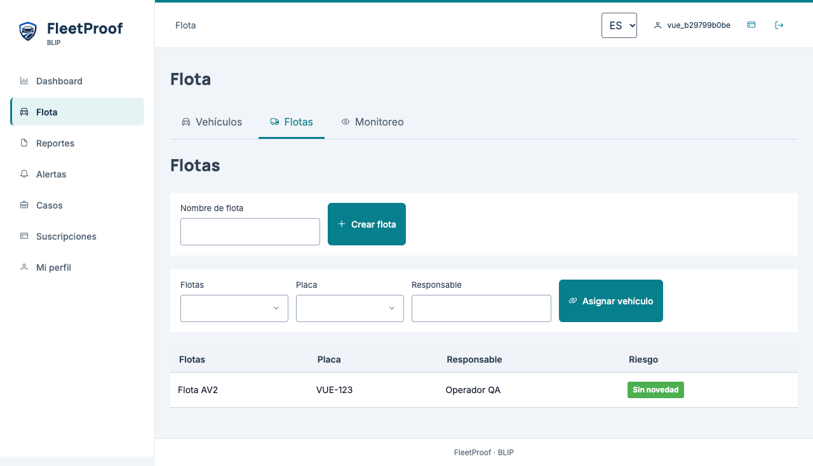

Figura 5.2.3-1. Asignación de un vehículo a una flota en la aplicación Vue durante la prueba local.

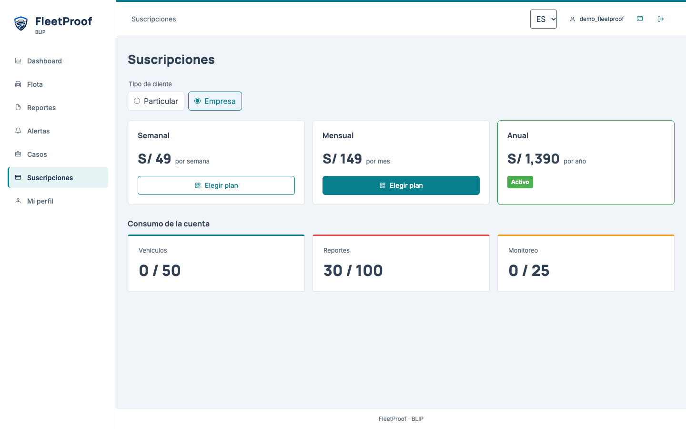

Figura 5.2.3-2. Catálogo de tres frecuencias en Vue.

El 14 de noviembre de 2026, desde la [aplicación pública](https://zesty-sorbet-f6d433.netlify.app/login), se registró una cuenta de prueba, se inició sesión y se guardó el vehículo ficticio `TST-483`. El vehículo continuó visible al recargar. También se comprobó que el catálogo mostraba las tres frecuencias.

<figure style="margin: 12pt 0; break-inside: avoid">
  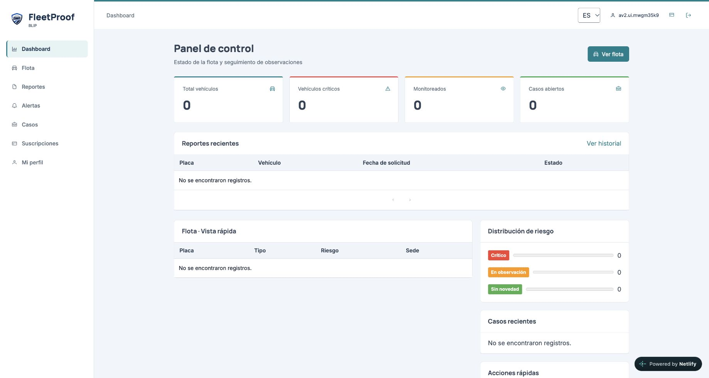
  <figcaption>Figura 5.2.3-3. Panel autenticado del frontend publicado, con navegación lateral y reportes recientes.</figcaption>
</figure>

<figure style="margin: 12pt 0; break-inside: avoid">
  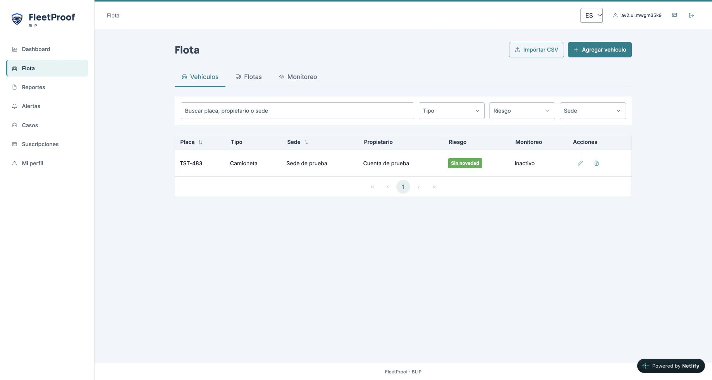
  <figcaption>Figura 5.2.3-4. El vehículo de prueba permanece visible tras recargar la vista Flota.</figcaption>
</figure>

<figure style="margin: 12pt 0; break-inside: avoid">
  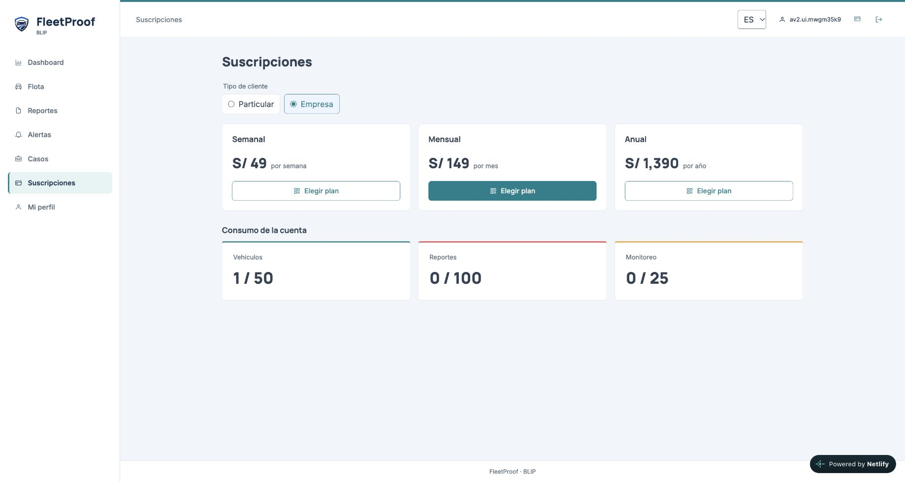
  <figcaption>Figura 5.2.3-5. Catálogo de planes semanal, mensual y anual en la aplicación pública.</figcaption>
</figure>

#### 5.2.3.6 Services Documentation Evidence for Sprint Review

El backend publica el [documento OpenAPI](https://fleetproof-platform.onrender.com/openapi/v1.json) y el [endpoint de salud](https://fleetproof-platform.onrender.com/api/v1/health). Ambos respondieron HTTP 200. La Web App consume la base `https://fleetproof-platform.onrender.com/api/v1`; el servidor autentica con Bearer y limita los recursos a la cuenta correspondiente. Subscription Management decide la elegibilidad y el ACL traduce esa decisión al permiso que consume Fleet Management. No se requiere HTTP entre esos dos módulos.

| Recurso | Operaciones de referencia | Resultado |
|---|---|---|
| `/health` | GET | Comprueba la conexión de la API con PostgreSQL. |
| `/authentication/sign-up`, `/authentication/sign-in` | POST | Registro y autenticación; el inicio exitoso devuelve el token de sesión. |
| `/subscriptions` | GET, POST; PUT por identificador | Consulta, alta y actualización de frecuencia, segmento y estado del plan. |
| `/vehicles`, `/fleets`, `/assignments` | GET y POST | Recursos de la cuenta. Sin plan activo, crear flota o asignación devuelve 403. |
| `/reports` | GET, POST; PUT por identificador | Consulta y gestión de reportes de demostración de la cuenta. |

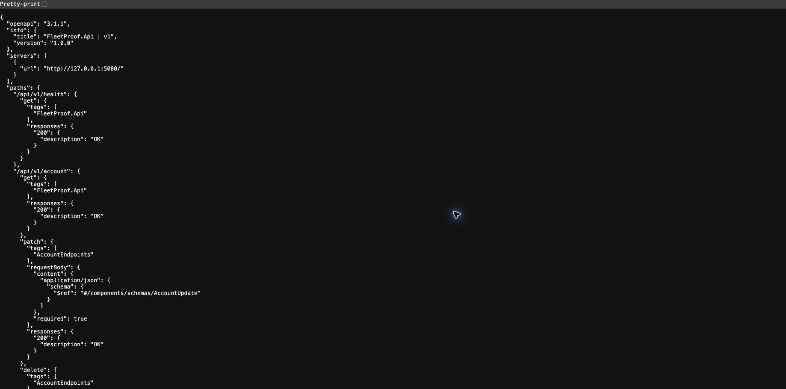

Figura 5.2.3-6. Especificación OpenAPI del backend FleetProof v1 consultada en el entorno local.


Figura 5.2.3-7. Respuesta `{"status":"ok"}` a `GET /api/v1/health` en local. La comprobación confirma que el backend pudo conectarse a PostgreSQL en ese entorno.

#### 5.2.3.7 Software Deployment Evidence for Sprint Review

El 12 de noviembre de 2026 se aprovisionó PostgreSQL 17 en Render, en la región Oregon. Desde la terminal local se ejecutó `dotnet ef database update` contra la base remota para aplicar el esquema antes de publicar el servicio C#.

| Producto | Publicación verificada | Evidencia |
|---|---|---|
| Landing Page | [GitHub Pages](https://upc-pre-202620-asi0730-8088-blip.github.io/fleetproof-website/), rama `main`. | `bf686b9` restaura el contenido anterior. La nueva versión de la landing para AV2 sigue pendiente. |
| Web Application | [Netlify](https://zesty-sorbet-f6d433.netlify.app/login), rama `develop`, commit `48f27d9`. Vue se compiló con la URL pública de Render y autenticación real. | [Publicación del frontend](https://app.netlify.com/projects/zesty-sorbet-f6d433/deploys/6af88a0a514969ab8779f55e), figura 5.2.3-11 y pruebas en 5.2.3.5. |
| Web Services | [Render](https://fleetproof-platform.onrender.com/api/v1/health), rama `main`, commit `c1177eb`. ASP.NET Core en Docker con PostgreSQL 17. | [Despliegue del backend](https://dashboard.render.com/web/srv-dbs7g7ei0phs73cbg380/deploys/dep-dbs7ooj0pb7s739o1te0), figura 5.2.3-10 y OpenAPI en 5.2.3.6. |

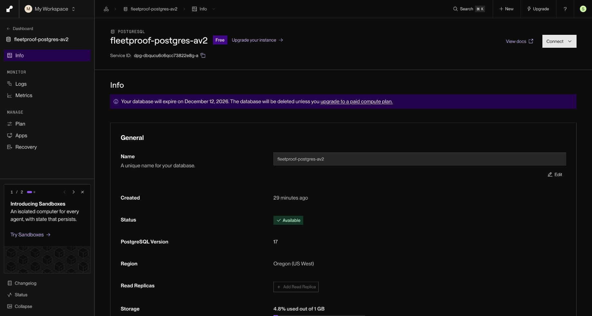

Figura 5.2.3-8. Instancia `fleetproof-postgres-av2` disponible en Oregon en el plan Free de Render.

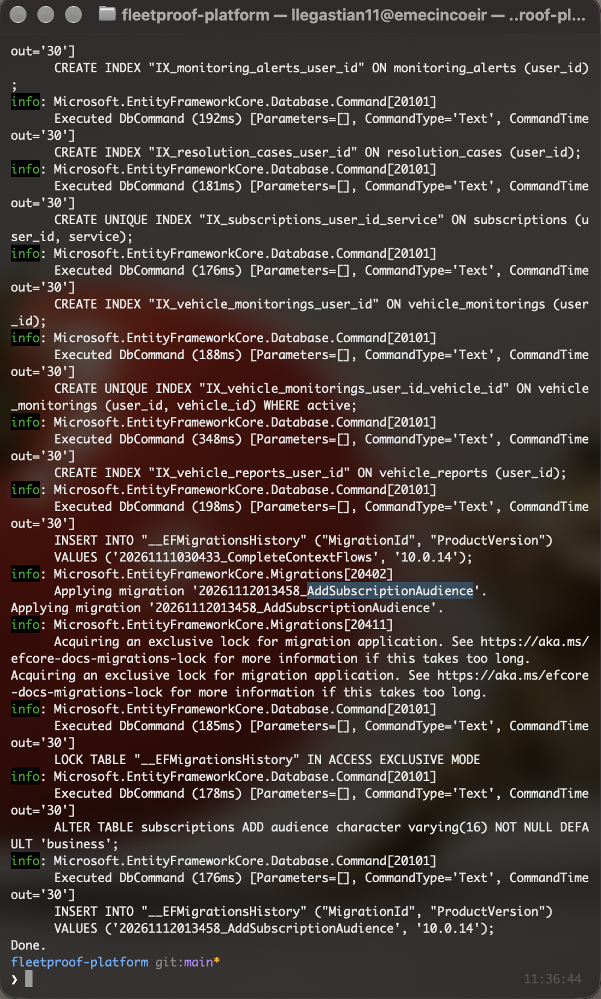

Figura 5.2.3-9. Aplicación de la migración `AddSubscriptionAudience` a la base remota. La salida final `Done.` confirma que el comando terminó.

<figure style="margin: 12pt 0; break-inside: avoid">
  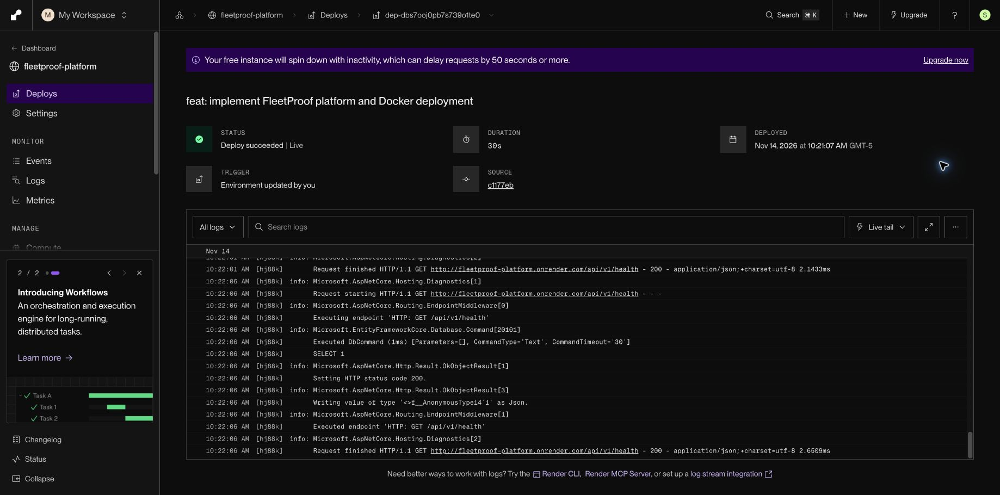
  <figcaption>Figura 5.2.3-10. Servicio Docker activo en Render. Las comprobaciones de salud registran HTTP 200.</figcaption>
</figure>

<figure style="margin: 12pt 0; break-inside: avoid">
  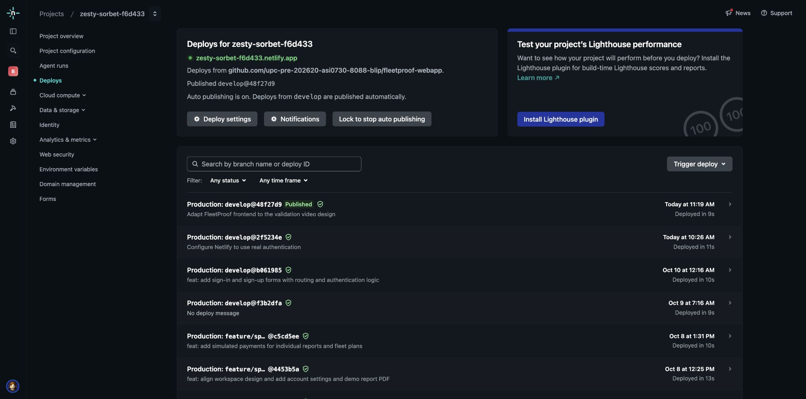
  <figcaption>Figura 5.2.3-11. Netlify registra como publicado el commit 48f27d9 de develop.</figcaption>
</figure>

**Releases en GitHub**

| Producto | Versión publicada | Alcance |
|---|---|---|
| Landing Page | [v2.0.0](https://github.com/upc-pre-202620-asi0730-8088-blip/fleetproof-website/releases/tag/release/v2.0.0) | Versión previa a AV2. El sitio vigente conserva su contenido. |
| Web Application | [v1.1.0](https://github.com/upc-pre-202620-asi0730-8088-blip/fleetproof-webapp/releases/tag/v1.1.0) | Frontend de AV2 publicado en Netlify desde el commit `48f27d9`. |
| Web Services | [v1.0.0](https://github.com/upc-pre-202620-asi0730-8088-blip/fleetproof-platform/releases/tag/v1.0.0) | Backend de AV2 desplegado en Render desde el commit `c1177eb`. |
| Informe | [av2-capitulo-5](https://github.com/upc-pre-202620-asi0730-8088-blip/fleetproof-report/releases/tag/av2-capitulo-5) | Prerelease de revisión del capítulo 5, correspondiente al commit `bbc545b`. |

#### 5.2.3.8 Team Collaboration Insights during Sprint

Se separaron las correcciones por capítulo para facilitar su revisión e integración. La evidencia disponible son las [ramas de Sprint 3](https://github.com/upc-pre-202620-asi0730-8088-blip/fleetproof-report/branches) y los commits enumerados arriba. La matriz LACX no sustituye contribuciones verificables. Para cerrar la sección faltan PR y revisiones de los productos, además de capturas de analíticos con repositorio, rama y período.

## 5.3 Validation Interviews

Se registran las entrevistas de validación de AV2, separadas de las entrevistas de levantamiento del Capítulo II. Los enlaces corresponden a las grabaciones compartidas por el equipo.

### 5.3.1 Diseño de entrevistas

**Objetivo.** Identificar si los segmentos reconocen el punto de entrada del producto y entienden el alcance de un reporte puntual frente al seguimiento de vehículos. Se reconstruyó la pauta a partir de los dos archivos MOV de FleetProof y su transcripción; las preguntas surgieron durante la conversación y no se presentan como un cuestionario aplicado textualmente a todos.

| Segmento | Escenario y elemento mostrado | Recorrido de la Web Application | Preguntas reconstruidas a partir de la sesión |
|---|---|---|---|
| Consulta individual | Cristhian evalúa cómo investigar un vehículo usado. Se muestra la consulta por placa y sus resultados. | Plantear la consulta → mostrar reporte y fuentes → conversar sobre vigencia y alertas posteriores. | ¿Dónde buscarías información antes de comprar? ¿Qué datos del historial consultarías? ¿Cómo distinguirías una consulta puntual del seguimiento? |
| Gestión empresarial | Roxana evalúa qué priorizaría al supervisar vehículos en distintas sedes. Se muestra el panel y se explica el flujo de flotas. | Abrir el panel → localizar el riesgo → abrir el detalle → mostrar la activación y el registro de una flota. | ¿Qué mirarías primero? ¿Qué información reúnes hoy y cuánto trabajo implica? ¿En qué escenario usarías esta herramienta? |

**Moderación y registro.** El moderador mostró el flujo, hizo preguntas abiertas y solicitó comentarios. Se registraron el tramo, la observación y su implicación. No se midieron tiempo por tarea, tasa de éxito ni uso autónomo. Los fotogramas muestran la interfaz de referencia del curso paralelo de Open Source: las sesiones aportan evidencia sobre la propuesta y los flujos compartidos, pero no acreditan una prueba de usabilidad de la aplicación Vue de Aplicaciones Web. El recorrido mostrado a Roxana no valida el plan Empresa con los cerca de 25 vehículos que administra. Para una ronda posterior se debe probar la Landing Page y pedir a participantes que ejecuten los flujos sin asistencia en Vue.

### 5.3.2 Registro de entrevistas

Después de las entrevistas, se adaptó la navegación de la aplicación Vue al diseño de referencia. La barra lateral, la cabecera y la paleta conservan los patrones visuales del recorrido mostrado. Se verificaron en Vue los flujos de registro, inicio de sesión, activación de plan, registro de vehículo y asignación a flota con el backend local. Las grabaciones corresponden a las sesiones originales y documentan las observaciones que motivaron la adaptación.

| Participante | Perfil de referencia | Grabación | Duración (mm:ss) y resultado observado |
|---|---|---|---|
| Roxana Limo | Gestión comercial automotriz; perspectiva empresarial. | [Validación con Roxana](https://drive.google.com/file/d/1rnyaSSVS_42uR4PmsGFv6SOQrKGxjh5N/view?usp=sharing) | **04:09.** En 00:50–00:54 señala la columna de riesgo. En 02:08–02:55 explica que supervisa alrededor de 25 vehículos en tres ciudades y que reunir datos de distintas áreas le toma tiempo. En 03:36–03:49 expresa intención de usar y recomendar la solución. |
| Cristhian Amaya | Asesoría automotriz; perspectiva de consulta y recomendación vehicular. | [Validación con Cristhian](https://drive.google.com/file/d/1CtNP9LyLidYjLD7K_gaAsz1zfq1H0Lq8/view?usp=sharing) | **03:50.** En 00:18–00:36 describe la consulta por placa en varias fuentes. En 01:21–01:48 pregunta por información registral relevante para la compra. En 02:37–03:17 pregunta cuándo se obtienen los datos y qué pasa si una infracción aparece después. |

La duración corresponde al archivo local, redondeada al segundo. El inicio de cada sesión en su grabación individual es `00:00`. No se consigna fecha u hora de sesión sin registro independiente.

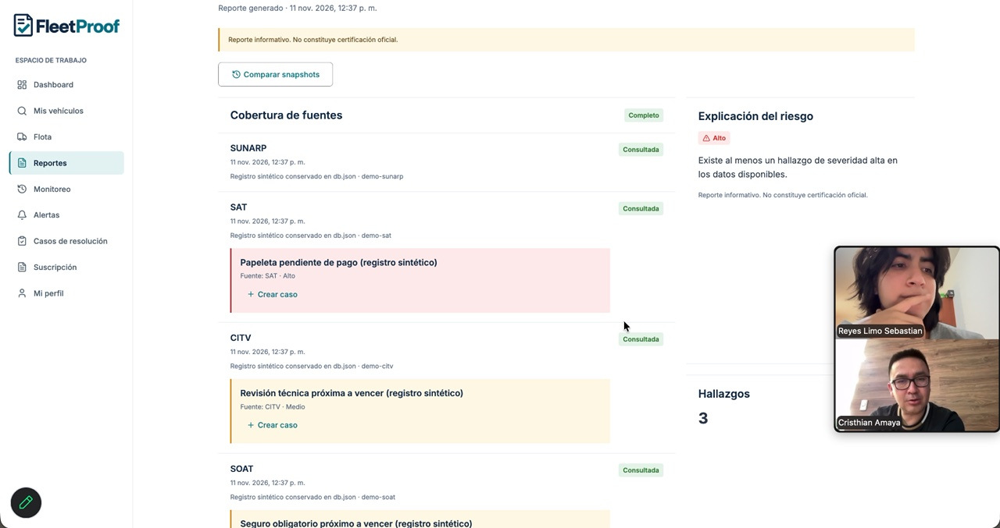

Figura 5.3-1. Cristhian, 01:42: revisión guiada de fuentes en la interfaz de referencia.

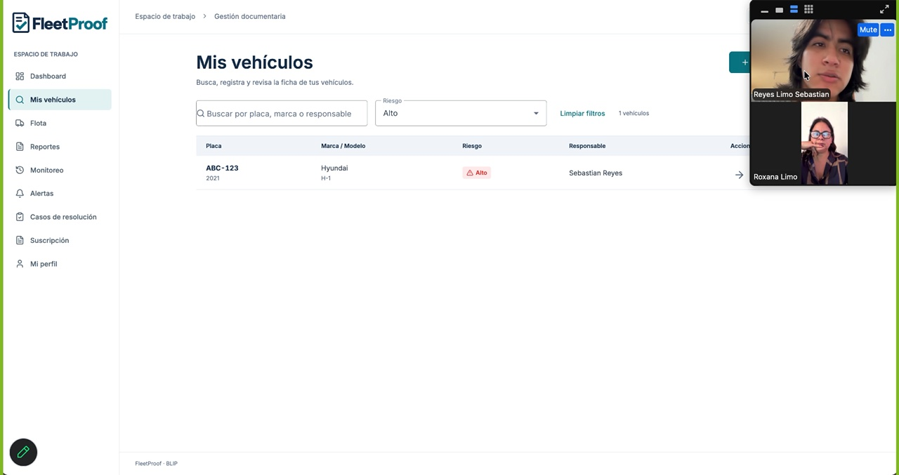

Figura 5.3-2. Roxana, 00:58: listado de vehículos con el riesgo destacado.

### 5.3.3 Evaluaciones según heurísticas

**UX Heuristics & Principles Evaluation**

**Usability – Inclusive Design – Information Architecture**

| Datos de identificación | Descripción |
|---|---|
| Carrera | Ingeniería de Software |
| Curso | Aplicaciones Web |
| Sección | 8088 |
| Profesores | Todos |
| Auditor | BLIP |
| Cliente(s) | Cristhian Amaya y Roxana Limo |

## Site o App a evaluar

### **FleetProof**

FleetProof es una solución web orientada a la consulta de
información vehicular y a la gestión de flotas.

La evaluación inicial toma como referencia las observaciones
registradas durante las entrevistas de validación realizadas
a representantes de los segmentos objetivo. Estas sesiones
se desarrollaron utilizando la interfaz de referencia del
producto.

La evaluación podrá complementarse mediante la inspección
heurística de la aplicación web implementada en Vue,
diferenciando los hallazgos de esta inspección de aquellos
obtenidos durante las entrevistas.

### Tareas a evaluar

El alcance de las sesiones de validación registradas
comprende las siguientes tareas y recorridos:

1. Identificación del punto de entrada para la consulta
   de información vehicular.
2. Comprensión de los resultados de una consulta por placa.
3. Identificación e interpretación de las fuentes de
   información presentadas en el reporte.
4. Identificación del nivel de riesgo vehicular desde
   el panel de control.
5. Comprensión de las diferencias entre una consulta
   puntual y el seguimiento posterior de un vehículo.
6. Reconocimiento del flujo de registro de una flota.

### Tareas excluidas de las sesiones registradas

Las siguientes actividades no fueron evaluadas
específicamente durante las sesiones de validación:

1. Interacción con el Landing Page.
2. Ejecución autónoma de tareas sin asistencia del moderador.
3. Verificación técnica de accesibilidad.
4. Recuperación ante errores durante la interacción.
5. Verificación del funcionamiento de las integraciones
   con fuentes externas.
6. Gestión de una flota empresarial en condiciones
   representativas de operación.

Estas exclusiones corresponden al alcance de las sesiones
registradas y no impiden realizar evaluaciones complementarias
sobre la aplicación implementada.

## Descripción de problemas


### PROBLEMA H01: Falta de claridad sobre el momento de consulta y actualización de los datos vehiculares

**Severidad:** 2 - Problema menor.

**Heurística incumplida:** Usabilidad - Visibilidad del estado del sistema.

**Problema:**

Durante la entrevista de validación realizada a Cristhian Amaya, entre los minutos 02:37 y 02:56, el participante manifestó dudas respecto al momento en que FleetProof obtiene la información vehicular, preguntando si los datos se consultan al generar el reporte o si proceden de una base de datos previamente almacenada.

Posteriormente, mediante la inspección de la Web Application ejecutada en un entorno local, se identificó que la vista de detalle del reporte presenta fechas asociadas a Consulta Vehicular, SOAT y SBS Accidentes sin etiquetas descriptivas que permitan determinar su significado.

Asimismo, en el panel de revisión y publicación del reporte se presenta una fecha debajo del estado Publicado, sin especificar si corresponde a la generación, revisión o publicación del reporte.

La ausencia de etiquetas descriptivas dificulta la diferenciación entre las fechas de consulta, actualización y publicación de la información vehicular.

Esta situación puede generar incertidumbre en los propietarios y compradores de vehículos, especialmente cuando necesitan interpretar la vigencia de los datos antes de tomar una decisión.

Se asigna una severidad preliminar de nivel 2 debido a que el problema dificulta la interpretación de la información, pero no impide continuar con la consulta vehicular.

**Evidencia:**

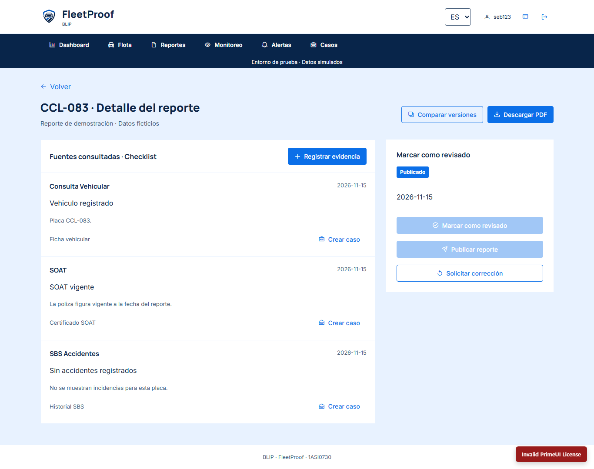

*Figura 5.3.3-1. Fechas sin etiquetas descriptivas en las fuentes consultadas y en el panel de publicación del reporte vehicular de FleetProof.*

Se observa que las fechas de las fuentes consultadas y del panel de publicación del reporte carecen de etiquetas descriptivas, lo que dificulta identificar si corresponden a la consulta, actualización o publicación de la información vehicular.

**Recomendación:**

Se recomienda mejorar la comunicación del estado y la vigencia de la información vehicular mediante las siguientes acciones:

- Incorporar etiquetas descriptivas junto a las fechas de cada fuente consultada.
- Diferenciar la fecha de generación del reporte de la fecha de consulta de cada fuente.
- Mostrar la fecha de última actualización de los datos cuando dicha información se encuentre disponible.
- Identificar explícitamente la fecha de publicación del reporte.
- Informar al usuario cuando no sea posible determinar la fecha de actualización de una fuente.
- Mantener visible la identificación de los datos simulados en el entorno de demostración.

Estas mejoras permitirían reducir la incertidumbre del usuario, mejorar la visibilidad del estado del sistema y facilitar la interpretación de la información presentada en los reportes vehiculares.

### PROBLEMA H02: Información insuficiente sobre el alcance y la cobertura de las fuentes consultadas

**Severidad:** 2 - Problema menor.

**Principio incumplido:** Arquitectura de información - Comprensibilidad de la información y sus etiquetas (Is it understandable?).

**Problema:**

Durante la entrevista de validación realizada a Cristhian Amaya, entre los minutos 01:21 y 01:59, el participante manifestó interés en conocer qué información registral y de revisiones técnicas puede consultar mediante FleetProof antes de adquirir un vehículo.

Posteriormente, durante la inspección de la Web Application ejecutada en un entorno local, se identificó que el diálogo Solicitar reporte únicamente presenta un campo para ingresar la placa del vehículo y un botón para continuar al pago simulado.

El diálogo no proporciona una descripción de las fuentes de información incluidas, los tipos de datos que se obtendrán ni las limitaciones del reporte vehicular.

Esta ausencia de información puede generar incertidumbre en los propietarios y compradores de vehículos, debido a que no cuentan con suficientes elementos para determinar si el reporte satisface sus necesidades antes de continuar con la solicitud.

Adicionalmente, en la vista de detalle del reporte se utilizan siglas como SOAT y SBS sin presentar sus denominaciones completas, lo que puede dificultar la comprensión de los resultados para usuarios que no poseen conocimientos especializados sobre información vehicular.

Se asigna una severidad preliminar de nivel 2 debido a que el problema afecta la comprensión del servicio ofrecido y la toma de decisiones informadas, pero no impide continuar con la solicitud del reporte.

**Evidencia:**

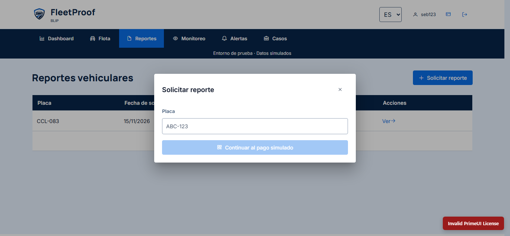

*Figura 5.3.3-2. Diálogo de solicitud de reporte vehicular sin información descriptiva sobre las fuentes incluidas y el alcance del servicio.*

Se observa que el diálogo permite ingresar la placa del vehículo y continuar al pago simulado, sin presentar información adicional sobre la cobertura del reporte. El hallazgo se limita a esta vista, sin afirmar que dicha información se encuentre ausente en todas las etapas posteriores del proceso.

**Recomendación:**

Se recomienda mejorar la comprensión del alcance del reporte vehicular mediante las siguientes acciones:

- Incorporar una descripción breve del contenido del reporte en el diálogo de solicitud.
- Presentar las fuentes de información incluidas antes de continuar al pago.
- Explicar los tipos de datos vehiculares que proporciona cada fuente.
- Complementar las siglas con sus denominaciones completas.
- Comunicar las limitaciones del reporte y de las fuentes de información.
- Incorporar mensajes de ayuda contextual que faciliten la comprensión del servicio.
- Diferenciar explícitamente los datos simulados de aquellos que procederían de consultas reales.
- Mantener visible la advertencia sobre el carácter informativo del reporte vehicular.

Estas mejoras permitirían reducir la incertidumbre de los usuarios, facilitar la comprensión de la información disponible y favorecer una toma de decisiones informada antes de solicitar un reporte vehicular.

### PROBLEMA H03: Diferenciación insuficiente entre la consulta puntual y el servicio de monitoreo continuo de vehículos

**Severidad:** 2 - Problema menor.

**Heurística incumplida:** Usabilidad - Correspondencia entre el sistema y el mundo real.

**Problema:**

Durante la entrevista de validación realizada a Cristhian Amaya, entre los minutos 02:56 y 03:17, el participante preguntó qué sucedería si se registrara una infracción de tránsito después de haber generado un reporte vehicular mediante FleetProof.

Esta observación evidenció la necesidad de comunicar con mayor claridad las diferencias entre una consulta vehicular puntual y el servicio de monitoreo.

Posteriormente, durante la inspección de la Web Application ejecutada en un entorno local, se identificó que la vista Monitoreo presenta la siguiente descripción: "Revisiones de datos locales mientras esta vista permanece abierta. Sin worker en servidor ni consultas oficiales".

Si bien esta descripción comunica las limitaciones del servicio, utiliza términos técnicos como worker en servidor, cuyo significado puede resultar difícil de comprender para usuarios que no poseen conocimientos especializados en ingeniería de software.

Asimismo, la vista permite configurar el intervalo de revisión, activar el monitoreo y solicitar una revisión manual. Sin embargo, no presenta una explicación explícita sobre las diferencias entre estas funcionalidades y la generación de un reporte vehicular puntual.

Esta situación podría generar expectativas incorrectas respecto al seguimiento de los vehículos, especialmente sobre la continuidad de las revisiones después de cerrar la aplicación.

Se asigna una severidad preliminar de nivel 2 debido a que el problema afecta la comprensión del funcionamiento del servicio, pero no impide acceder a sus opciones de configuración.

**Evidencia:**

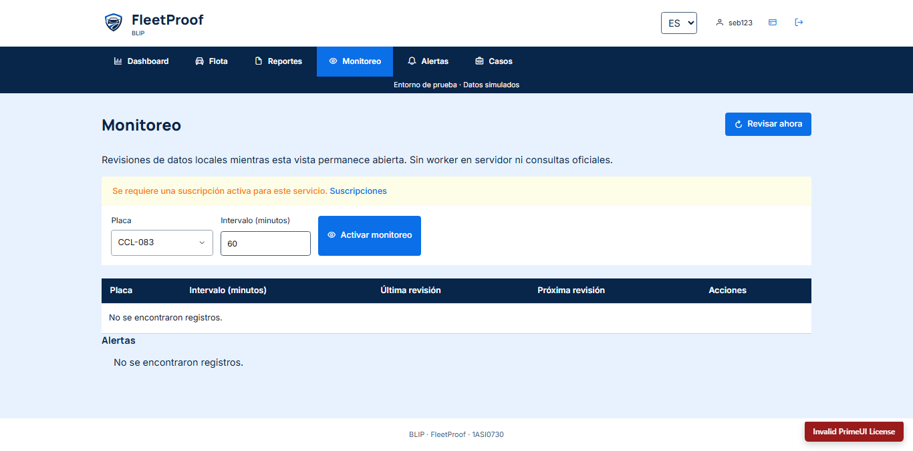

*Figura 5.3.3-3. Vista Monitoreo de FleetProof, donde se presenta una descripción técnica del funcionamiento y las limitaciones del servicio de seguimiento vehicular.*

Se observa que el diálogo de solicitud del reporte permite ingresar la placa del vehículo y continuar al pago simulado, sin proporcionar información sobre las fuentes consultadas, la cobertura ni las limitaciones del reporte vehicular.

**Recomendación:**

Se recomienda mejorar la comunicación del funcionamiento del monitoreo vehicular mediante las siguientes acciones:

- Sustituir los términos técnicos por expresiones comprensibles para los segmentos objetivo.
- Explicar las diferencias entre un reporte vehicular puntual y el servicio de monitoreo.
- Informar explícitamente que las revisiones se realizan únicamente mientras la vista de monitoreo permanece abierta.
- Comunicar que el servicio utiliza datos locales simulados y no realiza consultas a fuentes oficiales.
- Explicar el propósito del intervalo de revisión y de la opción Revisar ahora.
- Mantener visibles las condiciones necesarias para activar el monitoreo.
- Evitar generar expectativas sobre revisiones automáticas en segundo plano o notificaciones que todavía no se encuentran implementadas.

Como propuesta de mejora, se recomienda utilizar el siguiente mensaje:

"El monitoreo revisa los datos de tus vehículos según el intervalo seleccionado mientras mantienes esta pantalla abierta. Puedes solicitar una revisión manual en cualquier momento. Las revisiones se detienen al cerrar esta vista y no incluyen consultas a fuentes oficiales".

Estas mejoras permitirían establecer una correspondencia más clara entre las expectativas de los usuarios y el funcionamiento actual de FleetProof.

### PROBLEMA H04: Inconsistencia del idioma en las etiquetas de navegación cuando se selecciona español

**Severidad:** 1 - Problema superficial.

**Heurística incumplida:** Usabilidad - Consistencia y estándares.

**Problema:**

Durante la inspección de la Web Application de FleetProof ejecutada en un entorno local, se identificó una inconsistencia en la traducción de las etiquetas de navegación.

A pesar de encontrarse seleccionado el idioma español (ES), la barra de navegación superior conserva la etiqueta Dashboard en inglés, mientras que las demás opciones, como Flota, Reportes, Monitoreo, Alertas y Casos, se presentan en español.

Asimismo, al seleccionar la opción Dashboard, el encabezado de la vista presenta la denominación Panel de control. Esto evidencia que una misma funcionalidad se identifica mediante dos términos en idiomas diferentes.

Esta inconsistencia puede generar dificultades de comprensión para usuarios que no están familiarizados con términos en inglés y afecta la uniformidad del lenguaje utilizado en la aplicación.

El problema también representa una oportunidad de mejora en la aplicación de las características de internacionalización (i18n) establecidas en el enunciado del trabajo final.

Se asigna una severidad preliminar de nivel 1 debido a que la inconsistencia no impide acceder a las funcionalidades de FleetProof, pero afecta la consistencia de la experiencia de usuario.

**Evidencia:**

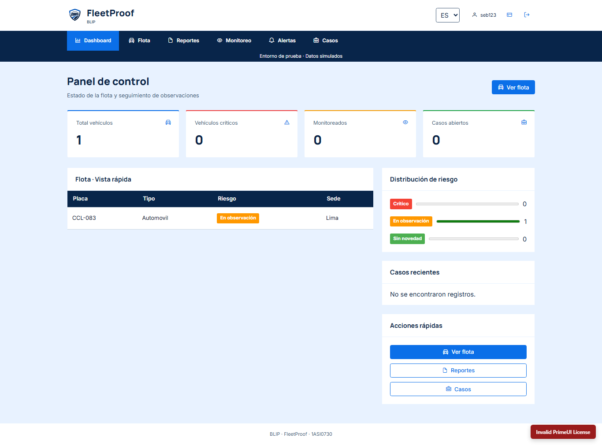

*Figura 5.3.3-4. Inconsistencia entre la etiqueta Dashboard de la barra de navegación y el encabezado Panel de control con el idioma español seleccionado.*

Se observa que, a pesar de encontrarse seleccionado el idioma español (ES), la barra de navegación conserva la etiqueta Dashboard en inglés, mientras que el encabezado de la misma vista utiliza la denominación Panel de control en español.

**Recomendación:**

Se recomienda mejorar la consistencia del idioma y la implementación de la internacionalización mediante las siguientes acciones:

- Incorporar todas las etiquetas de navegación en los recursos de internacionalización de la aplicación.
- Utilizar la denominación Panel de control tanto en la barra de navegación como en el encabezado de la vista cuando se seleccione español.
- Utilizar la denominación Dashboard cuando se seleccione inglés.
- Mantener una terminología uniforme para identificar las funcionalidades en las diferentes vistas.
- Revisar las traducciones de encabezados, botones, formularios y mensajes del sistema.
- Realizar pruebas de cambio de idioma para English (en_US) y Latin American Spanish (es_419).
- Verificar que el inglés se encuentre configurado como idioma predeterminado, según las especificaciones del enunciado del trabajo final.

Estas mejoras permitirían ofrecer una experiencia de usuario consistente, reducir las dificultades de comprensión y fortalecer las características de internacionalización de FleetProof.

### PROBLEMA H05: Acciones de gestión vehicular representadas mediante iconos sin etiquetas de texto visibles

**Severidad:** 2 - Problema menor.

**Principio incumplido:** Diseño inclusivo - Considera la situación (Consider situation).

**Problema:**

Durante la inspección de la Web Application de FleetProof ejecutada en un entorno local, se identificó que la columna Acciones de la tabla de vehículos presenta dos controles representados únicamente mediante iconos, sin etiquetas de texto visibles que expliquen sus respectivas funcionalidades.

El primer control utiliza un icono de lápiz, el cual permite acceder al diálogo de edición del vehículo. El segundo utiliza un icono de documento con un símbolo de adición, cuya interacción conduce a la vista de detalle de un reporte vehicular en estado Borrador.

Si bien el icono de lápiz puede resultar familiar para usuarios con experiencia en aplicaciones digitales, el significado del segundo icono podría resultar ambiguo para usuarios que interactúan por primera vez con FleetProof.

La dependencia de símbolos visuales para comunicar las acciones disponibles puede generar dificultades de comprensión en usuarios con distintos niveles de experiencia tecnológica, capacidades visuales o condiciones de interacción.

En dispositivos táctiles, también resulta importante que la identificación de las funcionalidades no dependa exclusivamente de posicionar el cursor sobre los controles.

Se asigna una severidad preliminar de nivel 2 debido a que el problema puede incrementar el esfuerzo necesario para reconocer las acciones disponibles, aunque no impide acceder a las funcionalidades de gestión vehicular.

**Evidencia:**

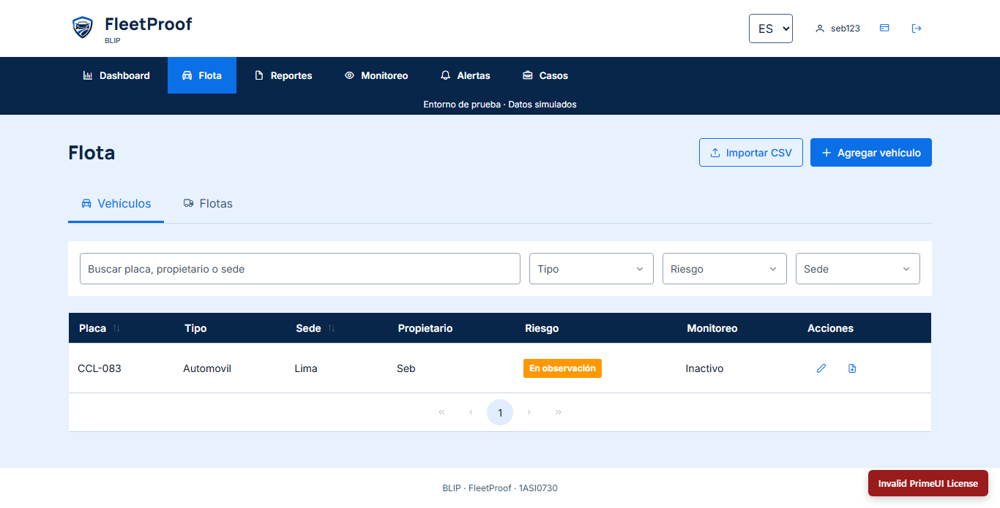

*Figura 5.3.3-5. Columna Acciones de la vista Flota, donde se presentan los controles de gestión vehicular mediante iconos sin etiquetas de texto visibles.*

* Al seleccionar el primer icono se presenta el diálogo Editar vehículo, que permite modificar la placa, el tipo de vehículo, la sede, el propietario y el estado de riesgo.
* Al seleccionar el segundo icono se accede a la vista de detalle de un reporte vehicular en estado Borrador.


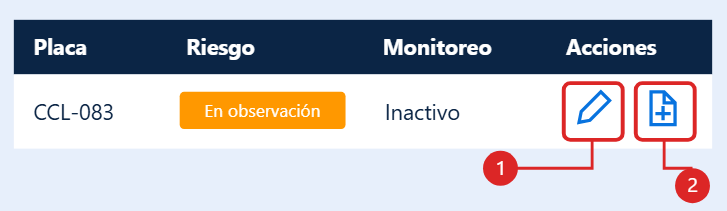

*Figura 5.3.3-6. Diálogo de edición presentado después de seleccionar el icono de lápiz y el segundo icono se accede a la vista de detalle de un reporte vehicular en estado Borrador.*

Se observa que los controles de la columna Acciones se representan únicamente mediante iconos sin etiquetas de texto visibles, lo que dificulta reconocer las funcionalidades de edición del vehículo y generación del reporte antes de interactuar con ellos.

**Recomendación:**

Se recomienda mejorar la comprensión y accesibilidad de los controles de gestión vehicular mediante las siguientes acciones:

- Complementar los iconos con etiquetas de texto que describan las acciones disponibles.
- Utilizar denominaciones comprensibles como Editar vehículo y Generar reporte, según el comportamiento efectivo de cada control.
- Incorporar mecanismos de ayuda contextual que expliquen el propósito de las acciones.
- Garantizar que la información proporcionada por estos mecanismos también pueda obtenerse mediante el teclado y la interacción táctil.
- Verificar que cada control cuente con un nombre accesible mediante texto visible o atributos ARIA adecuados.
- Comprobar que los controles puedan recibir el foco del teclado y que este sea perceptible visualmente.
- Verificar que el tamaño y la separación de los controles faciliten la interacción desde dispositivos móviles.
- Realizar pruebas complementarias con usuarios de distintos niveles de experiencia tecnológica y tecnologías de asistencia.

Estas mejoras permitirían reducir la ambigüedad de los controles, facilitar el reconocimiento de las funcionalidades y proporcionar una experiencia de usuario más inclusiva para los segmentos objetivo de FleetProof.

### PROBLEMA H06: Generación accidental de reportes duplicados por ausencia de confirmación y control de acciones repetidas

**Severidad:** 2 - Problema menor.

**Heurística incumplida:** Usabilidad - Prevención de errores.

**Problema:**

Durante la inspección de la Web Application de FleetProof se identificó que, al seleccionar la acción de reporte desde la vista Flota, el sistema redirige directamente al detalle de un reporte sin solicitar confirmación previa ni explicar con claridad que la acción generará un nuevo registro.

Como consecuencia, al repetir la interacción se generan múltiples reportes asociados a la misma placa, produciendo registros duplicados en la vista Reportes vehiculares.

Esta situación puede ocasionar errores involuntarios, incrementar la cantidad de registros innecesarios y dificultar la gestión de la información por parte del usuario.

Se asigna una severidad preliminar de nivel 2 debido a que el problema afecta la integridad operativa del flujo y puede generar confusión, aunque no impide continuar utilizando la aplicación.

**Evidencia:**

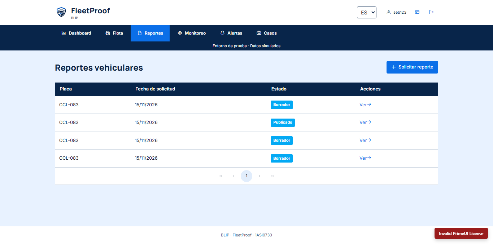

*Figura 5.3.3-8. Vista de reportes vehiculares con múltiples registros generados para la misma placa.*

Se observa que la acción de reporte permite generar más de un registro para la misma placa sin un mecanismo visible de confirmación, prevención de duplicados o advertencia previa.

**Recomendación:**

Se recomienda prevenir la generación accidental de reportes duplicados mediante las siguientes acciones:

- Solicitar confirmación antes de generar un nuevo reporte.
- Informar explícitamente al usuario que la acción creará un nuevo registro.
- Verificar si ya existe un reporte reciente o en borrador para la misma placa antes de registrar uno nuevo.
- Bloquear temporalmente la acción mientras se procesa la solicitud.
- Mostrar mensajes de confirmación o retroalimentación después de completar la generación del reporte.
- Diferenciar claramente entre ver un reporte existente y generar uno nuevo.

Estas mejoras permitirían reducir errores involuntarios, mejorar el control de las acciones del usuario y fortalecer la prevención de errores en FleetProof.

### PROBLEMA H07: Estado vacío con orientación insuficiente en la vista de Suscripciones

**Severidad:** 2 - Problema menor.

**Heurística incumplida:** Arquitectura de información - Orientación y comprensión de estados vacíos.

**Problema:**

Durante la inspección de la Web Application de FleetProof se identificó que la vista Suscripciones presenta un estado vacío en la tabla inferior mediante el mensaje "No se encontraron registros", sin ofrecer una explicación adicional sobre la ausencia de registros ni una orientación clara sobre la acción que debe realizar el usuario.

Aunque en la parte superior de la vista se muestran indicadores de uso para vehículos, reportes y monitoreo, la sección tabular no comunica si el usuario todavía no cuenta con una suscripción activa, si aún no ha completado un pago simulado o si simplemente no existen registros asociados.

Esta situación puede generar confusión, debido a que el usuario visualiza información de consumo y opciones para continuar al pago simulado, pero no recibe suficiente orientación contextual en la sección vacía.

Se asigna una severidad preliminar de nivel 2 debido a que el problema afecta la comprensión del estado actual del servicio, aunque no impide continuar con la navegación.

**Evidencia:**

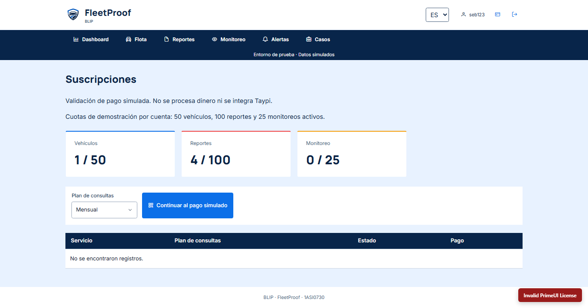

*Figura 5.3.3-9. Vista de Suscripciones con indicadores de uso visibles y tabla en estado vacío sin orientación adicional.*

Se observa que la tabla muestra el mensaje "No se encontraron registros" sin explicar el motivo de la ausencia de información ni sugerir una acción concreta para completar el flujo.

**Recomendación:**

Se recomienda mejorar la orientación del estado vacío en la vista de Suscripciones mediante las siguientes acciones:

- Explicar por qué no existen registros visibles en la tabla.
- Indicar si el usuario todavía no cuenta con una suscripción activa.
- Incorporar un mensaje de orientación que sugiera la acción siguiente, por ejemplo continuar al pago simulado o activar un plan.
- Relacionar de manera más clara los indicadores de uso con el estado de la suscripción.
- Mostrar mensajes distintos según la causa del estado vacío.

Estas mejoras permitirían reducir la incertidumbre del usuario y facilitar la comprensión del estado actual del servicio de suscripciones en FleetProof.


### PROBLEMA H08: Inconsistencia de colores en los indicadores de distribución de riesgo

**Severidad:** 2 - Problema menor.

**Heurística incumplida:** Usabilidad - Consistencia y estándares.

**Problema:**

En el panel de control de FleetProof se identificó una inconsistencia en la representación visual de los niveles de riesgo vehicular.

La categoría En observación se identifica mediante una etiqueta de color naranja; sin embargo, la barra correspondiente a su distribución se presenta en color verde, el cual también se encuentra asociado a la categoría Sin novedad.

Esta inconsistencia puede generar interpretaciones incorrectas sobre el estado de riesgo de los vehículos y dificultar la identificación rápida de situaciones que requieren atención.

Se asigna una severidad de nivel 2 debido a que el problema afecta la interpretación de los indicadores, aunque las etiquetas textuales permiten identificar el estado correspondiente.

**Evidencia:**

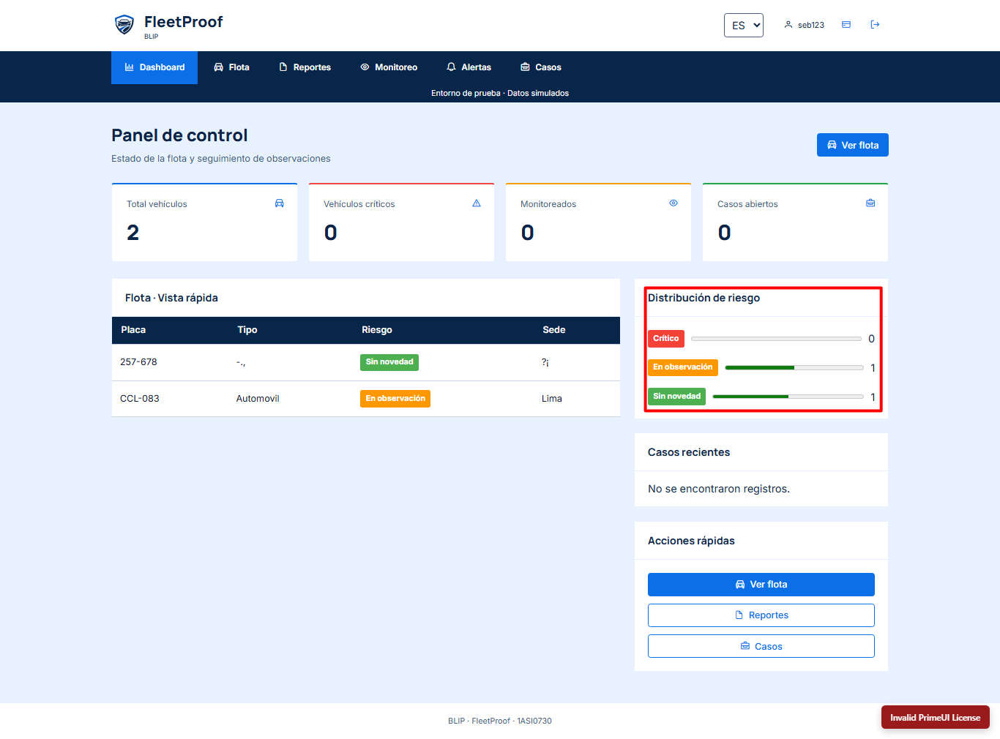

*Figura 5.3.3-10. Inconsistencia entre el color de la etiqueta y la barra de distribución del estado En observación.*

Se observa que la categoría "En observación" utiliza una etiqueta naranja y una barra verde, generando una inconsistencia en la representación visual del riesgo vehicular.

**Recomendación:**

- Utilizar una paleta de colores consistente para representar los niveles de riesgo.
- Emplear rojo para Crítico, naranja para En observación y verde para Sin novedad.
- Mantener la correspondencia entre las etiquetas, barras e indicadores de riesgo.
- Complementar los colores con etiquetas textuales para evitar que la interpretación dependa exclusivamente del color.
- Incorporar estas convenciones en el Design System de FleetProof.


### PROBLEMA H09: Dificultad para identificar y diferenciar reportes vehiculares

**Severidad:** 2 - Problema menor.

**Heurística incumplida:** Usabilidad - Reconocimiento antes que recuerdo.

**Problema:**

En la vista Reportes vehiculares de FleetProof se identificó que los registros se presentan mediante la placa del vehículo, la fecha de solicitud y el estado del reporte.

Cuando existen múltiples reportes asociados a una misma placa, generados durante el mismo día y con el mismo estado, la información visible resulta insuficiente para distinguirlos.

La tabla no presenta un identificador individual, una hora de generación ni un número de versión que permita reconocer cada reporte sin acceder a su contenido.

Como consecuencia, el usuario debe abrir individualmente los reportes para identificar cuál corresponde a la información que necesita consultar.

Se asigna una severidad de nivel 2 debido a que el problema incrementa el esfuerzo necesario para localizar un reporte específico, aunque no impide acceder a su contenido.

**Evidencia:**

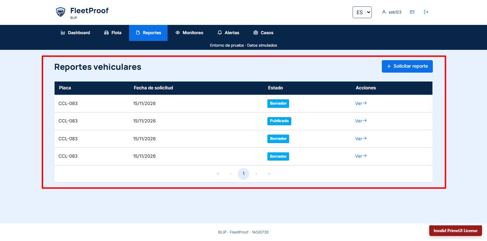

*Figura 5.3.3-11. Reportes asociados a una misma placa sin elementos visibles que permitan diferenciarlos.*

Se observa que varios reportes presentan la misma placa, fecha de solicitud y estado, sin un identificador visible que permita distinguirlos.

**Recomendación:**

- Incorporar un identificador único visible para cada reporte vehicular.
- Mostrar la fecha y hora de generación del reporte.
- Incorporar números de versión cuando corresponda.
- Permitir ordenar los reportes según su fecha y hora de creación.
- Facilitar la identificación de los reportes más recientes.
- Proporcionar información descriptiva que permita reconocer cada registro sin necesidad de abrirlo.


### PROBLEMA H10: Validación insuficiente de los datos ingresados en los formularios de gestión vehicular

**Severidad:** 3 - Problema mayor.

**Heurística incumplida:** Usabilidad - Prevención de errores.

**Problema:**

Durante la inspección de la Web Application de FleetProof se identificó que los formularios de gestión vehicular permiten almacenar valores que no corresponden al significado esperado de sus campos.

Se registró un vehículo con una placa exclusivamente numérica, caracteres especiales en los campos Tipo y Sede, y un valor exclusivamente numérico en el campo Propietario.

La aplicación permitió almacenar estos datos y mostrarlos posteriormente en el listado de vehículos, sin impedir el registro de valores incoherentes.

Esta situación puede afectar la calidad de la información vehicular, dificultar las operaciones de búsqueda y filtrado, y generar inconsistencias en los reportes y procesos de gestión de flotas.

Se asigna una severidad preliminar de nivel 3 debido al impacto potencial sobre la integridad de la información almacenada y las funcionalidades que dependen de ella.

**Evidencia:**

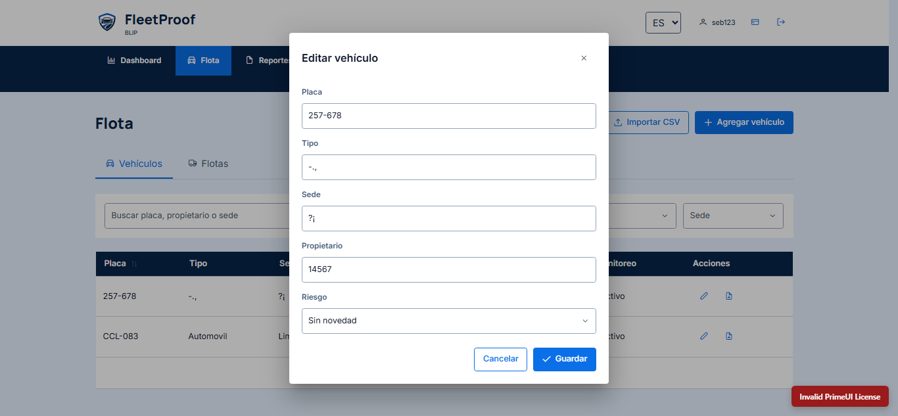

*Figura 5.3.3-12. Formulario de edición vehicular con valores que no corresponden al significado esperado de los campos.*

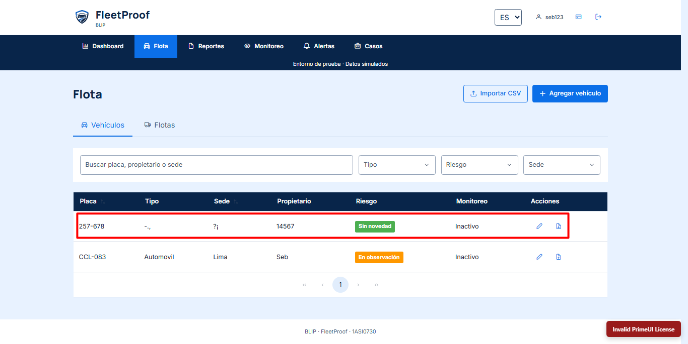

*Figura 5.3.3-13. Listado de vehículos que evidencia el almacenamiento de datos incoherentes.*

Se observa que la aplicación permite almacenar caracteres especiales como tipo de vehículo y sede, además de valores exclusivamente numéricos como propietario, sin aplicar restricciones suficientes sobre el contenido ingresado.

**Recomendación:**

- Implementar reglas de validación específicas para cada campo del formulario.
- Validar el formato de las placas según los tipos de matrícula admitidos por el negocio.
- Utilizar un selector con categorías válidas para el tipo de vehículo.
- Validar la información ingresada en los campos Sede y Propietario según las reglas del negocio.
- Mostrar mensajes de error descriptivos junto a los campos que contienen valores incorrectos.
- Impedir el almacenamiento de información que incumpla las reglas de validación.
- Implementar las validaciones tanto en el frontend como en el backend.
- Incorporar pruebas para verificar escenarios de ingreso de datos válidos e inválidos.

Estas mejoras permitirían prevenir errores de ingreso, preservar la integridad de la información vehicular y mejorar la confiabilidad de los procesos de gestión de flotas.


### PROBLEMA H11: Orientación insuficiente durante la importación de vehículos mediante archivos CSV

**Severidad:** 2 - Problema menor.

**Heurística incumplida:** Usabilidad - Ayuda y documentación.

**Problema:**

Durante la inspección de la Web Application de FleetProof se identificó que, al seleccionar la opción Importar CSV en la vista Flota, la aplicación abre directamente el explorador de archivos del sistema operativo.

Antes de seleccionar el archivo, la interfaz no presenta instrucciones sobre la estructura esperada del documento CSV, los encabezados de las columnas, los campos obligatorios ni los formatos admitidos.

Asimismo, no se observa una opción visible para descargar una plantilla que facilite la preparación del archivo.

Esta situación puede generar dificultades para los usuarios que necesitan registrar múltiples vehículos, debido a que deben preparar sus archivos sin conocer previamente la estructura requerida por FleetProof.

Se asigna una severidad preliminar de nivel 2 debido a que el problema incrementa el esfuerzo necesario para realizar la importación, aunque no impide acceder a la funcionalidad.

**Evidencia:**

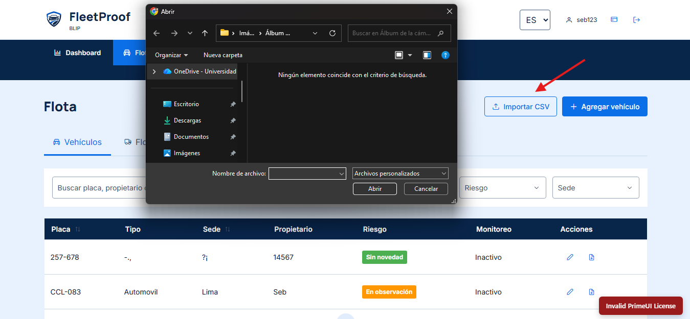

*Figura 5.3.3-14. Apertura directa del explorador de archivos al seleccionar la opción Importar CSV.*

Se observa que la aplicación solicita seleccionar un archivo CSV sin presentar previamente instrucciones sobre su estructura, campos obligatorios o formatos admitidos.

**Recomendación:**

- Incorporar un diálogo informativo antes de seleccionar el archivo CSV.
- Especificar los encabezados y campos obligatorios del documento.
- Proporcionar una plantilla CSV descargable.
- Incluir ejemplos de registros válidos.
- Presentar una vista previa de los datos antes de confirmar la importación.
- Informar sobre los registros incorrectos o duplicados detectados durante la importación.
- Incorporar mensajes de ayuda que faciliten la corrección de errores.

Estas mejoras permitirían reducir la incertidumbre del usuario, prevenir errores durante la preparación de archivos y facilitar el registro masivo de vehículos.


## 5.4 Video About-the-Product

El video About-the-Product presenta FleetProof a dos públicos: los visitantes del Landing Page, que quieren conocer el modelo de negocio y las características del producto, y los usuarios de la Web Application, que quieren ver las tareas que pueden realizar con ella. Tiene una orientación promocional, usa el tono del producto (claro, profesional y orientado a la prevención) y está narrado en español, con subtítulos en español y en inglés.

El video recorre el flujo desde el Landing Page hacia la Web Application conectada a los Web Services. El segmento de propietarios y compradores crea su cuenta, solicita un reporte por placa con pago de demostración y descarga el PDF. El segmento empresarial activa un plan, importa vehículos mediante un archivo CSV, crea una flota, asigna un responsable y activa el seguimiento, y revisa el panel de control en escritorio y en móvil. Incluye una opinión de cada segmento, tomada de las sesiones de validación de 5.3: Roxana Limo (empresas con flota) y Cristhian Amaya (propietarios y compradores), quienes autorizaron el uso de sus sesiones en este trabajo. Las escenas de la aplicación indican en pantalla que los datos y los pagos son de demostración.

Las tomas de la aplicación se grabaron con la Web Application (rama `develop`, commit `48f27d9`) y los Web Services (repositorio `fleetproof-platform`, base `c1177eb`) ejecutados en local con PostgreSQL. La rama del backend usada incluía además el historial de revisiones de monitoreo, que no aparece en el video. Las sesiones de validación se realizaron con una interfaz de referencia, por lo que el video muestra solo el recuadro de la videollamada y la frase de cada participante.

| Elemento | Detalle |
|---|---|
| Archivo | `upc-pre-202620-1asi0730-8088-blip-about-the-product-sprint-3.mp4` |
| Duración | 2 min 10 s (00:02:10) |
| URL en Microsoft Stream | [Video About-the-Product en Microsoft Stream](https://upcedupe-my.sharepoint.com/:v:/g/personal/u202221024_upc_edu_pe/IQCQ6V5wfx5fQrCdjl89rGCsARuOrdOL1O6iodVaMBtRpBs?nav=eyJyZWZlcnJhbEluZm8iOnsicmVmZXJyYWxBcHAiOiJPbmVEcml2ZUZvckJ1c2luZXNzIiwicmVmZXJyYWxBcHBQbGF0Zm9ybSI6IldlYiIsInJlZmVycmFsTW9kZSI6InZpZXciLCJyZWZlcnJhbFZpZXciOiJNeUZpbGVzTGlua0NvcHkifX0&e=kdfgch) |
| URL en YouTube (incrustado en el Landing Page) | [https://youtu.be/zLoyj8Rw4oA](https://youtu.be/zLoyj8Rw4oA) |

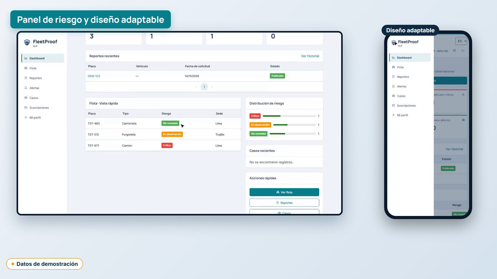

**Figura 5.4-1.** Cuadro del video About-the-Product (00:01:25).
*Fuente: Elaboración propia.*

### Pauta de secuencias

| Momento | Contenido |
|---|---|
| 00:00:00 | El problema: consultas en varios portales, hojas de cálculo y mensajes. |
| 00:00:10 | Presentación de FleetProof, de BLIP, y su propuesta de valor. |
| 00:00:19 | Los dos segmentos en el Landing Page: empresas con flota y propietarios o compradores; selector de idioma ES/EN. |
| 00:00:29 | Segmento de propietarios y compradores: del Landing Page a la aplicación, registro, reporte por placa con pago de demostración y descarga del PDF. |
| 00:00:53 | Segmento empresarial: activación del plan, importación CSV, flotas, responsable y seguimiento. |
| 00:01:21 | Panel de control con la distribución de riesgo y diseño adaptable (escritorio y móvil). |
| 00:01:29 | Presentación de los testimonios de las sesiones de validación. |
| 00:01:36 | Testimonio de Roxana Limo (empresas con flota). |
| 00:01:45 | Testimonio de Cristhian Amaya (propietarios y compradores). |
| 00:01:55 | Modelo de suscripción y cierre. |

### Testimonios incluidos

| Participante | Segmento | Fragmento de la sesión de validación | Frase que aparece en el video |
|---|---|---|---|
| Roxana Limo | Empresas con flota | [Validación con Roxana](https://drive.google.com/file/d/1rnyaSSVS_42uR4PmsGFv6SOQrKGxjh5N/view?usp=sharing), 03:40–03:49 | «Claro que sí, sí, me parece súper interesante. Es más, se lo recomendaría a los clientes corporativos que tenemos que compren flotas.» |
| Cristhian Amaya | Propietarios y compradores | [Validación con Cristhian](https://drive.google.com/file/d/1CtNP9LyLidYjLD7K_gaAsz1zfq1H0Lq8/view?usp=sharing), 03:24–03:34 | «Sí, sí, me interesa: uno para comprar el carro y otro para el monitoreo del carro, pero todo con el tema de las fotopapeletas.» |

Los dos testimonios expresan interés en usar la solución. El de Roxana incluye además la intención de recomendarla a clientes corporativos. Los subtítulos en español y en inglés se entregan junto con el video en el archivo .zip de complementarios.
